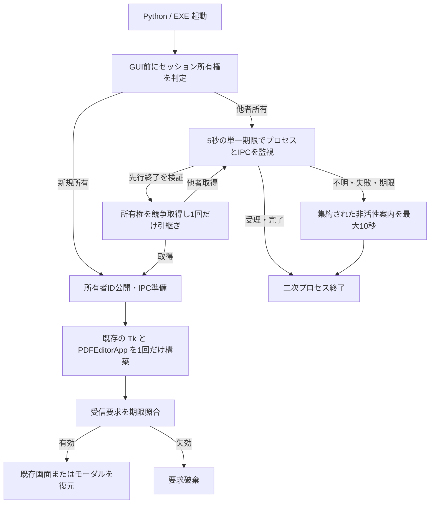

# Phase 4: 起動制御と既存画面への復帰 - Research

**Researched:** 2026-10-21  
**Domain:** Windows 11 の単一起動、プロセス間復帰要求、Tk 画面復帰  
**Confidence:** MEDIUM（Win32 仕様と現行コードは確認、Windows 実機の結合結果は未取得）

<user_constraints>
## User Constraints (from CONTEXT.md)

以下は `04-CONTEXT.md` の実装決定、裁量、保留事項を原文のまま転記したもの。[VERIFIED: .planning/phases/04-startup-control/04-CONTEXT.md:16-84,106-109]

### Locked Decisions

### 正常に復帰したときの表示

- **D-01:** 正常復帰の通知は追加しない。ヘッダーやトーストを出さず、OCR の進捗と現在のステータス表示を維持する。
- **D-02:** 最小化前のウィンドウ状態へ復元する。最大化していた場合は最大化、通常サイズだった場合はそのサイズに戻す。
- **D-03:** 短時間の連続起動はまとめて1回の復帰として扱い、何度もフォーカスが移るのを防ぐ。独立した新たな起動操作まで恒久的に抑止しない。
- **D-04:** 通常編集画面への復帰では直前のキーボード操作先を維持する。入力欄やページ一覧から作業を続けられるようにし、PDF プレビューへ一律に移さない。

### 初回起動の準備中に再起動した場合

- **D-05:** 最初の画面の準備中は何も表示せず待つ。準備ができたら既存画面へ戻し、待機上限を超えた場合だけ案内する。
- **D-06:** 既存画面の準備を待つ時間は **最大5秒**。
- **D-07:** 待機中に先行プロセスが起動失敗で終了したことを確認できた場合だけ、2回目の起動が引き継ぎ、自動起動を **1回だけ** 試す。終了したか不明な場合は追加画面を作らない。単に応答がないことを終了と見なさない。
- **D-08:** 5秒で時間切れを案内した後は、その復帰要求による前面化を行わない。遅れて既存画面の準備が整っても失効した要求を実行しない。必要なら利用者が改めて起動操作を行う。これは二次起動の復帰要求の契約であり、一次起動そのものの通常表示を取消す要求ではない。

### 起動判定・連絡に失敗した場合

- **D-09:** 確認できた理由と次の操作を簡潔に表示し、通常表示には技術的な詳細を併記しない。判定失敗・接続失敗・時間切れなどを、確認できた事実に応じて案内する。権限差などの原因を未確認のまま断定しない。
- **D-10:** 失敗の案内は手動でも閉じられ、操作しなくても **10秒で自動的に閉じる**。後続の起動処理は有限時間で終了する。編集画面を追加したり、確認操作待ちで無期限に残留したりしない。
- **D-11:** 案内の表示中に同じ失敗が繰り返されても、案内を増やさず、表示時間も延長しない。最初の表示から10秒で閉じる。複数の起動プロセスにまたがる連打も考慮する。
- **D-12:** 失敗案内を表示してもキーボードの操作先を変えない。他アプリや既存 PageFolio での入力を妨げない。

### ダイアログ表示中の復帰と前面化できない場合

- **D-13:** 設定画面・保存確認などのモーダルダイアログが開いている場合は、入力内容・選択状態を維持し、操作中のダイアログへ戻す。親の編集画面だけを前へ出してダイアログを隠したり、ダイアログを閉じて作り直したりしない。
- **D-14:** OS に前面表示を拒否された場合は **タスクバーの強調だけ** で知らせる。追加の案内画面・トーストは出さない。前面化拒否は D-09 の起動判定・連絡失敗とは別に扱う。
- **D-15:** タスクバーの強調は数回点滅した後、短時間で止める。利用者が戻るまで無期限に点滅させない。
- **D-16:** 前面化拒否後の自動再試行はしない。タスクバーのクリック、または独立した新たな起動操作で戻る。後から突然前面化する処理を残さない。

### the agent's Discretion

ユーザーから決定の一括委任はなく、上記16件は個別回答と全体確認で確定した。次は要件を守る実装詳細として調査・計画で決める。

- 起動排他・通知・受信確認・要求失効の方式、モジュール構成、API 型、例外処理、監視周期。研究資料の mutex/event 案は候補であり採用決定ではない。
- D-03 の集約時間、D-11 の同一原因の識別とプロセス間集約方式、D-15 の具体的な点滅回数・時間。
- 5秒の待機と10秒の失敗案内を区別し、後続プロセスの全経路で終了上限を計画に明記する。再試行で5秒の待機期限を無制限に更新しない。D-07 で一次起動を引き継いだ場合と、二次起動として終了する場合を区別する。
- D-08 は送信側が終了するだけでは満たせない。受信側にも遅延した要求の失効が必要。単なる通知イベントの送信成功を、画面復帰の完了と混同しない。
- D-07 の引き継ぎでは、別の起動プロセスとの競合時も1画面を守る。ロックの強制解除や既存プロセスの終了で実現しない。
- 失敗案内は編集画面の生成前でも必要で、既存アプリへの通信自体が失敗した場合にも表示・集約・自動終了を満たす設計にする。既存のアプリ内 ToastManager をそのまま使えるとは仮定しない。
- Windows 11 実機で最小化/最大化、別アプリ前面、ダイアログ階層、入力先維持、OCR 中、権限差、初期化中の終了・時間切れ・連打を検証する。自動テストと実機確認の結果を分けて記録する。

### Deferred Ideas (OUT OF SCOPE)

議論中の新規追加要望はない。既存の保留項目（起動 PDF 引数転送、最近使ったファイル/閲覧位置復元、異常終了後の編集復旧、外部プロンプト保存失敗通知、OCR 共通化、実 API UAT）は今回に含めない。設定 I/O 通知と配布サンプル・最終リリース検証はロードマップどおり Phase 5/6 が担当する。
</user_constraints>

<phase_requirements>
## Phase Requirements

| ID | Description（原文） | Research Support |
|---|---|---|
| V110-START-01 | 「利用者は同一ログインセッション内で、連続・同時起動や対応版の別配置・別版・Python/EXE 混在起動をしても、編集画面を1つだけ使用できる。」 | 製品固定の `Local\` 識別子、GUI 前の原子的所有権、競合試験 |
| V110-START-02 | 「利用者は正常終了・強制終了・起動途中の異常終了の後に再起動でき、残留ロックで起動不能にならない。」 | OS ハンドルの寿命、初期化例外、終了キャンセル、クラッシュ試験 |
| V110-START-03 | 「利用者は排他判定や既存画面との連絡に失敗したとき、その失敗を『起動済み』と区別して認識できる。後続起動は追加の編集画面を作らず、有限時間で終了する。」 | 独立失敗案内と共有集約、絶対期限、全失敗経路の終了時間 |
| V110-FOCUS-01 | 「利用者は2回目の起動操作で既存画面へ戻れる。最小化中は復元され、OS が許可すれば前面表示され、拒否時には視覚的な通知で既存画面を見つけられる。」 | Tk メインスレッドでの復元、前面化結果、有限タスクバー点滅 |
| V110-FOCUS-02 | 「利用者は2回目の起動後も、未保存の編集、Undo/Redo、OCR の進行、開いているモーダルダイアログの操作を失わず続行できる。」 | 現行 app インスタンス不変、モーダル優先、入力先保持テスト |

上の ID・要件文は `.planning/REQUIREMENTS.md:21-28` を開いて原文引用した。[VERIFIED: .planning/REQUIREMENTS.md:21-28]
</phase_requirements>

## Summary

既存の `pagefolio.py` は `pagefolio.__main__.main` に委譲し、現在の `main()` は `TkinterDnD.Tk()` または `tk.Tk()`、`PDFEditorApp`、D&D、`mainloop()` の順に実行する。起動判定は最初の root 作成前に置ける。[VERIFIED: pagefolio.py:8-11; pagefolio/__main__.py:19-26] `PDFEditorApp.__init__` は設定、UI、プラグイン、Undo/Redo を構築するため、後続起動では呼ばない。[VERIFIED: pagefolio/app.py:138-218]

排他の最小核は固定製品 ID のセッション名前空間の named mutex。Microsoft は `Local\` をセッション名前空間と定義し、`CreateMutexW` の既存判定と所有権を説明している。ただし「named mutex が存在する」ことと「所有者が稼働中」は同一でない。`WaitForSingleObject` の `WAIT_ABANDONED` は所有**スレッド**終了を示し、先行**プロセス**終了の証明としては単独で足りない。[CITED: https://learn.microsoft.com/en-us/windows/win32/termserv/kernel-object-namespaces] [CITED: https://learn.microsoft.com/en-us/windows/win32/api/synchapi/nf-synchapi-createmutexw] [CITED: https://learn.microsoft.com/en-us/windows/win32/api/synchapi/nf-synchapi-waitforsingleobject]

**Primary recommendation:** GUI より先に固定名 mutex を所有し、所有者 PID と生成時刻を検証可能な共有状態へ公開する。二次起動は単一の5秒期限内で識別済みプロセスの終了または IPC の terminal ACK を待ち、受信側でも期限切れ要求を破棄する。採用方式と受入条件は下記 Open Questions のとおり計画で確定した。Windows 上での成立性は A1〜A5 が未実証であり、04-01-02 の実測を後続プラン開始の条件とする。[計画根拠: 04-01-PLAN.md / 04-01-02; 04-02-PLAN.md / execution_contract]

## Architectural Responsibility Map

| Capability | Primary Tier | Secondary Tier | Rationale |
|---|---|---|---|
| 所有権と引継ぎ | OS / 起動入口 | プロセス間通信 | Tk 作成前に原子的に決める。[CITED: https://learn.microsoft.com/en-us/windows/win32/api/synchapi/nf-synchapi-createmutexw] |
| 復帰要求の期限管理 | 起動入口 / IPC | Tk メインスレッド | 送信・受信双方の失効判定が必要。[VERIFIED: .planning/phases/04-startup-control/04-CONTEXT.md:37-40,69-71] |
| 画面状態・モーダル・入力先 | 既存 GUI | Win32 表示 API | 現行 app をそのまま操作する。[VERIFIED: pagefolio/app.py:138-218,641-665] |
| 失敗案内と連打集約 | 起動前 UI / OS 同期 | IPC | 通信不能でも動作が必要。[VERIFIED: .planning/phases/04-startup-control/04-CONTEXT.md:47-54,72-73] |

## Project Constraints (from AGENTS.md)

- `pagefolio/` の Mixin 構成と内部 `_` メソッド名、テーマ辞書 `C`、フォント用 `self._font(delta)`、日本語・英語の文言キー同期を守る。[VERIFIED: AGENTS.md:21-38; pagefolio/CLAUDE.md:11-14]
- ボタン追加時のスタイルは通常 `"TButton"`、主要 `"Accent.TButton"`、破壊的操作 `"Danger.TButton"`、トリミング ON `"CropOn.TButton"`。原文値「`"TButton"`」「`"Accent.TButton"`」「`"Danger.TButton"`」「`"CropOn.TButton"`」。[VERIFIED: AGENTS.md:30-37]
- ページ変更後は `_refresh_all()`、操作完了時は `_set_status(msg)`、ファイル操作前は `_check_doc()`、CropBox は MediaBox 内にクランプ、設定は `_save_settings()` で JSON 保存。Phase 4 の正常復帰は D-01 により新たなステータス表示を発生させない。[VERIFIED: AGENTS.md:39-46; .planning/phases/04-startup-control/04-CONTEXT.md:18-21]
- 作業は1タスクずつ完了させる。今回の調査は製品コードを変更しない。[VERIFIED: AGENTS.md:48-50]
- Tk UI はメインスレッド、OCR は別スレッド。既存 Document と Undo Blob は作り直さず、スタックの直接 `append` / `clear` をしない。[VERIFIED: AGENTS.md:81-95; pagefolio/CLAUDE.md:58-66]
- `pyproject.toml` 編集、裸の `except:`、無断の `# type: ignore` を禁止。Python 編集後は `ruff check . && ruff format .`、コミット前は全件 `pytest`。構文確認、開発履歴、版番号のチェックリストがある。ただし現行ロードマップでは Phase 4 の版番号同期は Phase 6 担当。[VERIFIED: AGENTS.md:39-65; .planning/ROADMAP.md:117-121]
- GSD workflow の外では直接編集しない。親の `/gsd-plan-phase 4` がこの研究文書作成の入口。[VERIFIED: AGENTS.md:103-117]
- `.agents/skills/session-handoff/SKILL.md` は終了時の日本語申し送り書式。計画担当は最終応答時に適用する。[VERIFIED: AGENTS.md:72-77; .agents/skills/session-handoff/SKILL.md:11-38]

## Standard Stack

| Component | Version / API | Purpose | Evidence |
|---|---|---|---|
| Python 標準 `ctypes` / `ctypes.wintypes` | 実行中 Python に同梱 | Windows API の型付き呼出し | [CITED: https://docs.python.org/3/library/ctypes.html] |
| Win32 named mutex とプロセス handle | `CreateMutexW`, `WaitForSingleObject`, `OpenProcess` | セッション単位排他と終了確認 | [CITED: https://learn.microsoft.com/en-us/windows/win32/api/synchapi/nf-synchapi-createmutexw] [CITED: https://learn.microsoft.com/en-us/windows/win32/api/processthreadsapi/nf-processthreadsapi-openprocess] |
| 既存 Tk / tkinterdnd2 | `tkinterdnd2==0.6.2`（現行固定値） | 主画面と画面上の UI 操作 | `requirements.txt:4` の原文「`tkinterdnd2==0.6.2`」。[VERIFIED: requirements.txt:4; pagefolio/__main__.py:11-26] |
| 既存 pytest / Ruff | `pytest==9.1.1`, `ruff==0.15.20`（現行固定値） | 障害注入と品質ゲート | `requirements.txt:8-10` の原文「`pytest==9.1.1`」「`ruff==0.15.20`」。[VERIFIED: requirements.txt:8-10] |

追加 pip パッケージを前提にしない。現行固定値を更新する調査ではなく、`pyproject.toml` も編集しない。[VERIFIED: AGENTS.md:46-53] **Package Legitimacy Audit:** 新規外部パッケージの導入は提案しないため対象外。

## Architecture Patterns

### System Architecture Diagram



図は推奨設計であり未実装。D-07 の「先行終了を検証」は PID のみでなく生成時刻と保持中の process handle を照合し、`WaitForSingleObject(process, 0)` の signaled を用いる。ID 公開前の異常終了については mutex の abandoned / 解放だけでプロセス死を断定しないので、確証を得られない場合は案内へ進める。[ASSUMED] [CITED: https://learn.microsoft.com/en-us/windows/win32/api/synchapi/nf-synchapi-waitforsingleobject] [CITED: https://learn.microsoft.com/en-us/windows/win32/api/processthreadsapi/nf-processthreadsapi-getprocesstimes]

### Recommended Project Structure

`pagefolio/__main__.py` を組込入口、Tk 非依存の新規 `pagefolio/startup_control.py` を OS 同期・IPC の境界、既存 `pagefolio/app.py` を画面復帰の接点、`tests/test_startup_control.py` を故障注入の単位試験とする設計を推奨する。[ASSUMED] これら新規ファイル名は提案であり、現存パスの主張ではない。

### Pattern 1: 排他・プロセス死・引継ぎを別の事実として扱う

`CreateMutexW` は既存名なら `ERROR_ALREADY_EXISTS`、失敗なら NULL を返す。既存名と API 失敗を別の分岐にする。最初の所有者は mutex を UI 全寿命で保持し、`root.destroy()` 完了または初期化例外の後に閉じる。終了確認をキャンセルした場合は保持し続ける。[CITED: https://learn.microsoft.com/en-us/windows/win32/api/synchapi/nf-synchapi-createmutexw] [VERIFIED: pagefolio/app.py:498-507]

二次起動が終了を確認しても、所有権を再取得するまで `PDFEditorApp` を作らない。同時に二者が引継ぎを試す場合は mutex の単一所有が決着する。公開 PID が未取得、`OpenProcess` がアクセス拒否、生成時刻不一致、先行プロセスが生存中の場合はいずれも引継ぎ禁止。[ASSUMED] [CITED: https://learn.microsoft.com/en-us/windows/win32/api/processthreadsapi/nf-processthreadsapi-openprocess]

### Pattern 2: 期限付き要求と受理・完了 ACK

起動操作ごとに単調時計で `deadline = start + 5秒` を一度だけ定める。通信の再試行、受理 ACK、引継ぎ確認も同じ残余時間から算出する。要求に一意 ID と絶対失効時刻を載せ、受信側は GUI 実行直前に失効を再判定して破棄する。送信成功は復帰完了ではない。`accepted`、`expired`、`completed`、`foreground_denied` を別結果として定義し、後続起動は確認された結果だけを案内へ反映する。5秒を過ぎてからの ACK は正常復帰として扱わない。[ASSUMED] [VERIFIED: .planning/phases/04-startup-control/04-CONTEXT.md:31-53,69-71]

IPC は要求 ID と返信を運べる overlapped named pipe を採用し、待機・読書きすべてに期限を適用する。同期 pipe I/O は無期限にブロックし得るため使用しない。受信スレッドは有界 queue への投入だけを行い、Tk メインスレッドが `root.after()` で取り出す。worker から Tk API を呼ばない。これは採用設計であり、期限内終了の実証は A1 に残る。[計画根拠: 04-01-PLAN.md / 04-01-02] [CITED: https://learn.microsoft.com/en-us/windows/desktop/ipc/synchronous-and-overlapped-input-and-output] [CITED: https://docs.python.org/3/library/tkinter.html]

pipe を選ぶ場合は同一マシンの起動連絡に限定し、`PIPE_REJECT_REMOTE_CLIENTS` とクライアントアクセスを限定するセキュリティ記述子を使う。識別子だけを認証とみなさず、要求サイズと種別を制限する。[CITED: https://learn.microsoft.com/en-us/windows/win32/api/namedpipeapi/nf-namedpipeapi-createnamedpipew] [CITED: https://learn.microsoft.com/en-us/windows/win32/ipc/named-pipe-security-and-access-rights] [ASSUMED]

後続プロセスの契約として、API 判定失敗は直ちに案内へ進み「案内開始から10秒＋有限の破棄時間」、既存所有者がいる場合は「起動操作から最大5秒の判定・通信＋案内開始から10秒＋有限の破棄時間」、正常復帰は5秒以内に終了、検証済み先行終了からの引継ぎは一次起動へ移行して通常の GUI 寿命となる、を明記する。破棄時間の実測上限は Windows 試験で固定し、無期限 join / pipe I/O は許さない。[ASSUMED] [VERIFIED: .planning/phases/04-startup-control/04-CONTEXT.md:27-53,67-71]

### Pattern 3: 現行 UI の復帰

`SettingsDialog` は `grab_set()` を使い、`_open_settings` は既存ダイアログを保持する。復帰処理は現在の grab と現存する子ダイアログを確認し、最深の操作可能ダイアログを対象とする。通常画面では `focus_get()` 等から直前の入力先を保存・確認して、プレビューへ強制移動しない。[VERIFIED: pagefolio/dialogs/settings.py:29-36; pagefolio/app.py:641-665]

`GetWindowPlacement` は最小化中には `showCmd` が最小化を示し、取得した `flags` は常に 0 と Microsoft が記す。ゆえに現在の placement だけから「最小化前に最大化だった」ことを推定しない。アプリ稼働中に最後の非最小化状態を追跡し、`SW_RESTORE` 後の実状態を確認して、必要な場合だけ最大化へ戻す方式を Windows 実機で検証する。[CITED: https://learn.microsoft.com/en-us/windows/win32/api/winuser/nf-winuser-getwindowplacement] [CITED: https://learn.microsoft.com/en-us/windows/win32/api/winuser/ns-winuser-windowplacement] [ASSUMED]

`SetForegroundWindow` の戻り値 0 は OS 拒否として扱い、`FlashWindowEx` の `FLASHW_TRAY` と有限 `uCount` を使用する。`FLASHW_TIMER` / `FLASHW_TIMERNOFG` は継続点滅を指示するため D-15 に使わない。拒否後は再試行タイマーを残さない。[CITED: https://learn.microsoft.com/en-us/windows/win32/api/winuser/nf-winuser-setforegroundwindow] [CITED: https://learn.microsoft.com/en-us/windows/win32/api/winuser/ns-winuser-flashwinfo]

連打集約窓は最初の有効な復帰処理後 **500 ms**、タスクバー強調は **3回・250 ms 間隔**を初期計画値として推奨する。いずれもユーザーの固定値ではなく、Windows 実機で「独立した新起動を永久抑止しない」「短時間で停止する」を検証して調整する。[ASSUMED]

### Pattern 4: 編集画面に依存しない失敗案内

失敗案内は OS 同期の独立名を原因クラス別に持ち、最初に取得したプロセスだけが非活性の小窓を表示して10秒の単調時計期限を保持する。同原因の後続プロセスは既存案内を確認して直ちに終了し、時刻を更新しない。手動閉じ・異常終了時は通知所有権を解放する。判定 API 自体が拒否されても追加編集画面を作らず、有限時間で終了するフェイルクローズ経路を用意する。[ASSUMED] 新規小窓の非活性表示、手動閉じと `WS_EX_NOACTIVATE` の両立、権限差をまたぐ集約は Windows 11 実機で先に検証する。[ASSUMED]

集約キーは表示文面ではなく「排他判定失敗」「既存画面との通信失敗」「準備待機の期限切れ」の原因クラスを推奨する。原因が証明されていない権限差は分類・文言に含めない。先頭の案内プロセスが取得した10秒の期限は後続プロセスから書き換えられないようにする。[ASSUMED] [VERIFIED: .planning/phases/04-startup-control/04-CONTEXT.md:42-54]

### Anti-Patterns to Avoid

- 固定名 auto-reset event だけで要求を表す。要求 ID・期限・受理/完了が運べず、遅延復帰を防げない。[VERIFIED: .planning/phases/04-startup-control/04-CONTEXT.md:69-71]
- root や `PDFEditorApp` 作成後に排他判定する。二窓の構築と設定・プラグイン副作用を先に起こす。[VERIFIED: pagefolio/__main__.py:19-26; pagefolio/app.py:138-218]
- mutex の `ERROR_ALREADY_EXISTS` や IPC 無応答を、そのまま「既存画面は正常」と解釈する。[CITED: https://learn.microsoft.com/en-us/windows/win32/api/synchapi/nf-synchapi-createmutexw]
- `SW_RESTORE`、`focus_force()`、topmost 化を無条件に重ねる。入力先や OS の前面化制約と衝突する。[VERIFIED: .planning/phases/04-startup-control/04-CONTEXT.md:20-25,55-62] [CITED: https://learn.microsoft.com/en-us/windows/win32/api/winuser/nf-winuser-setforegroundwindow]

## Don't Hand-Roll

| Problem | Don't Build | Use Instead | Why |
|---|---|---|---|
| 排他とクラッシュ後の解放 | PID だけのロックファイル、時刻での強制解除 | Windows named mutex と process handle | PID 再利用・競合・残骸を避ける。[CITED: https://learn.microsoft.com/en-us/windows/win32/api/synchapi/nf-synchapi-createmutexw] [CITED: https://learn.microsoft.com/en-us/windows/win32/procthread/process-handles-and-identifiers] |
| 画面復帰の状態判定 | 最小化中の placement だけから旧状態を推定 | 最後の非最小化状態を保持し、Tk 状態と Windows `GetWindowPlacement` で照合 | `GetWindowPlacement` の `flags` は取得時常に 0。[CITED: https://learn.microsoft.com/en-us/windows/win32/api/winuser/nf-winuser-getwindowplacement] |
| 前面化失敗の代替 | 無限再試行、常時 topmost | `FlashWindowEx` の有限 `FLASHW_TRAY` | OS の制約を尊重する。[CITED: https://learn.microsoft.com/en-us/windows/win32/api/winuser/ns-winuser-flashwinfo] |

## Common Pitfalls

1. **初期化中の窓:** mutex 取得後から IPC 準備まで二次起動が来る。サーバ未公開は所有者死の証明にならない。5秒内に待ち、確証がなければ案内で終了する。[VERIFIED: .planning/phases/04-startup-control/04-CONTEXT.md:27-40]
2. **生存確認と所有権の混同:** `WAIT_ABANDONED` はスレッド終了、`WAIT_OBJECT_0` は取得を示す。公開 PID・生成時刻・process handle を使う設計の成立性を Windows 検証で先に確かめる。[CITED: https://learn.microsoft.com/en-us/windows/win32/api/synchapi/nf-synchapi-waitforsingleobject] [ASSUMED]
3. **無期限 I/O:** named pipe の同期操作は相手の無応答で停止し得る。deadline を connection と read/write と ACK 全体へ適用する。[CITED: https://learn.microsoft.com/en-us/windows/desktop/ipc/synchronous-and-overlapped-input-and-output]
4. **送信後の失効漏れ:** secondary が5秒で退出しても受信側 queue に要求が残り、後で勝手に前面化する。Tk 処理直前に期限と要求 ID を確認する。[VERIFIED: .planning/phases/04-startup-control/04-CONTEXT.md:38-40,69-71]
5. **案内の多重表示:** `ToastManager` は主画面内で `_build_ui()` 後に作られる。起動前失敗には別経路が要る。[VERIFIED: pagefolio/toast.py:15-33; pagefolio/__main__.py:19-26]
6. **DoD ゲートの偽赤:** `_collect_phase_dirs()` が未完了の live directory も列挙し、`_collect_dod_violations()` が全件に VALIDATION を要求する。計画前の Phase 4 が失敗する。[VERIFIED: tests/test_gsd_dod.py:115-181] `04-CONTEXT.md` に単一プロセス実行「1409 passed / 1 failed / 1 warning」と記録されている。[VERIFIED: .planning/phases/04-startup-control/04-CONTEXT.md:77-81]

## Code Examples

擬似コードは方式の責務境界を示し、実装済みコードではない。具体的な API、要求・返信型、ファイルパスは 04-01/02-PLAN.md の採用設計に従う。[計画根拠: 04-01-PLAN.md / 04-01-02; 04-02-PLAN.md / 04-02-01]

```text
start = monotonic(); deadline = start + 5.0
claim = acquire_product_owner_before_tk()
if claim == OWNED:
    try: initialize_existing_application_once(); publish_ready(); mainloop()
    finally: close_ipc_and_owner_after_gui_destroyed()
elif claim == OTHER_OWNER:
    while monotonic() < deadline:
        if verified_predecessor_process_exited():
            try_claim_once_atomically(); break
        result = send_request_with_id_and_deadline(remaining(deadline))
        if result == COMPLETED: exit_secondary()
    if still_secondary: show_deduplicated_nonactivating_failure_for_10s(); exit()
else:
    show_deduplicated_nonactivating_failure_for_10s(); exit()

on_primary_receive(request):
    if request.deadline <= monotonic(): return EXPIRED
    schedule_on_tk_main_thread(request)
on_tk_main_thread(request):
    if request.deadline <= monotonic(): return EXPIRED
    target = current_modal_or_main_window()
    restore_previous_show_state(target)
    return foreground_or_finite_taskbar_flash(target)
```

共有時計は `GetTickCount64` のミリ秒値を採用し、wire に `issued_tick` と二次起動開始時の `deadline_tick = start_tick + 5000` を載せる。通信再試行でも期限を更新せず、受信時・Tk 実行直前・復元/前面化の各副作用直前に照合する。別プロセスの順序付き handshake と時刻変更時の挙動による成立性確認は A5 の未実施実測であり、採用済みという理由だけで合格にしない。[計画根拠: 04-01-PLAN.md / 04-01-02; 04-02-PLAN.md / 04-02-01]

## State of the Art

既存研究の「mutex + event」案は通知の起点として有用だが、今回確定した D-08 の受信側失効と D-11 のプロセス間案内集約までを表現しない。計画は ACK と期限のある IPC を追加する。[VERIFIED: .planning/research/SUMMARY.md:22-28; .planning/phases/04-startup-control/04-CONTEXT.md:69-73] 追加 package の版更新は不要。

## Assumptions Log

以下の A1〜A5 はすべて実証未実施のまま維持する。Open Questions の RESOLVED は設計選択と受入・停止条件の確定を示し、この表の成立性や製品動作の検証済みを意味しない。

| # | Claim | Section | Risk if Wrong |
|---|---|---|---|
| A1 | named pipe を最小 IPC に採用し、全操作を期限内に閉じられる | Architecture | ctypes 実装複雑化。初回 Windows 技術検証で確定 |
| A2 | mutex 所有者 PID・生成時刻を共有状態へ安全に公開できる | Architecture | 初期化前死亡の引継ぎ証明ができない。確証がなければ案内へ |
| A3 | 非活性・手動閉じ可の起動前小窓を Tk/Win32 で安定表示できる | Architecture | D-10/12 を満たせない。実機試作が必要 |
| A4 | 別権限プロセス間でも通知同期名を共有できる適切な ACL が構成できる | Security | D-11 の権限差経路が未充足 |
| A5 | 受信プロセスと送信プロセス間で期限の比較に使う時計形式を確定できる | Code Examples | 遅延復帰や早期失効 |

## Open Questions — RESOLVED（設計・受入条件）

2026-10-21 の計画確定時に、3問の採用仕様と判定方法を以下のとおり解決した。根拠は既存 PLAN のタスクと CONTEXT の決定であり、新たな実機証拠ではない。設計選択の未解決事項はないが、A1〜A5 の実証はすべて未実施。`04-VALIDATION.md` は `draft`、各検証は `pending` のままとする。

1. **RESOLVED: IPC と所有者メタデータの公開方式。** 標準 ctypes による固定名 `Local\PageFolio.Startup.Owner` mutex、`Local\PageFolio.Startup.State` の4096bytes pagefile-backed mapping、overlapped named pipe を採用する。所有者だけが Tk 生成前に PID・生成時刻・session・generation・ready 等を公開し、読取側は偶数 sequence の同一 snapshot を二度読んで部分更新を拒否する。process handle の生成時刻・session・logon SID と pipe peer PID を照合する。DACL は現在の logon SID と SYSTEM の必要権限に限定し、medium mandatory label を明示する。全 I/O は二次開始時に一度定める `GetTickCount64 + 5000ms` の期限を共有し、期限時は `CancelIoEx`、cleanup は500ms以内とする。D-07 に従い、識別済み process handle の終了確認と原子的な所有権再取得がそろった場合だけ1回引き継ぎ、公開前死亡・部分公開・PID再利用・確認不能を終了の証拠にしない。
   - **計画根拠:** `04-01-PLAN.md` の discovery と 04-01-02、`04-02-PLAN.md` の 04-02-01/02。D-05〜D-08 の期限・引継ぎ・失効契約を具体化する。
   - **残る実証・停止条件:** A1 は無応答 pipe の全 I/O 有界終了、A2 は所有者識別と部分公開/PID再利用拒否、A4 は同一 logon の medium/elevated 双方向作成順の共有、A5 は別プロセス時計比較と時刻変更非依存を実測する。いずれも未実施または不合格なら後続プランを開始しない。ACL 拡大、別名ロック、待機延長で受入条件を緩めない。

2. **RESOLVED: 非活性失敗案内の実装。** 編集用 Tk root と ToastManager から独立した `CreateWindowExW` 小窓を採用し、`WS_EX_NOACTIVATE | WS_EX_TOOLWINDOW`、`SW_SHOWNOACTIVATE`、`WM_MOUSEACTIVATE → MA_NOACTIVATE` で表示・閉じるクリックを扱う。初回 `ShowWindow` から10000msの期限を固定し、手動閉鎖または期限で破棄する。原因クラス別の `NoticeLease` は起動所有権/既存 IPC から独立した Local mutex とし、原子的取得者だけが表示する。同原因の後続起動は既存 lease を検証して退出し、表示数や期限を増やさない。D-09〜D-12 の事実分類・10秒・プロセス間集約・入力先維持をこの方式で実装する。
   - **計画根拠:** `04-01-PLAN.md` の 04-01-02 に本番 primitive と A3/A4、`04-04-PLAN.md` の 04-04-01/02 に3分類、非活性表示、原因別集約、最大15.5秒の二次終了契約がある。
   - **残る実証・停止条件:** A3 は他アプリの入力先を維持したまま手動/10秒閉鎖できること、A4 は権限差を跨ぐ lease 共有を実デスクトップで確認する。未実施/不合格なら拡張を停止する。通知 OS の生成不能や通知同期のアクセス拒否を「表示済み」「既存案内あり」と扱わず、04-04 でも解決不能なら実装完了を止める。

3. **RESOLVED: 復帰の完了定義。** `accepted` は queue 受理だけで成功ではない。Tk メインスレッドの復帰 callback の実結果と完了 tick を terminal ACK として返し、`completed`、`foreground_denied`、`expired` を区別する。前面化拒否は `foreground_denied` のまま送信元へ返し、通信失敗や `completed` に変換しない。拒否時は D-14〜D-16 に従いタスクバーを3回・250ms間隔で強調し、2秒以内に停止する。追加案内・自動前面化再試行はしない。5秒以後の ACK は正常復帰とせず、各副作用直前にも期限を確認する。D-03 の500ms固定集約窓内でも前回の terminal 結果を保持し、拒否を成功へ変換しない。
   - **計画根拠:** `04-01-PLAN.md` の 04-01-02、`04-02-PLAN.md` の 04-02-01、`04-03-PLAN.md` の 04-03-01、`04-04-PLAN.md` の 04-04-01。D-01/D-03/D-08/D-14〜D-16 を満たす完了契約として固定済み。
   - **残る検証・停止条件:** tracer は実 main→実 mutex/pipe→既存 Tk callback→terminal ACK を確認し、受理のみ・期限後 ACK・子プロセス残留を不合格とする。拒否・期限失効・集約は故障注入でも検証し、実 OS の前面化/点滅・操作先は 04-05 の Windows UAT で別記録する。mock の成功を実機合格へ読み替えない。

**共通の実行ゲート:** 04-01-02 は A1〜A5 の環境・入力条件・期待・実測・合否を `04-TRACER-EVIDENCE.md` に記録する。1件でも不合格/未実施なら親へ戻し、04-02 以降は開始しない。このゲートと各問の停止条件を確定したことが設計上の解決であり、A1〜A5 の合格や Phase 4 完了の宣言ではない。[計画根拠: 04-01-PLAN.md / 04-01-02; 04-02-PLAN.md / execution_contract; 04-VALIDATION.md / Per-Task Verification Map]

## Environment Availability

| Dependency | Required By | Available | Version / Evidence | Fallback |
|---|---|---|---|---|
| Windows | Win32 API と GUI 実機確認 | ✓ | `Microsoft Windows NT 10.0.26300.0` を環境照会 | 実機検証不能なら Phase gate 未完了 |
| `.venv/Scripts/python.exe` | 既存テスト | ✓ | Python 3.15.0 を実測 | 既存仮想環境を優先 |
| `.venv/Scripts/pytest.exe` | 自動テスト | ✓ | pytest 9.1.1 を実測 | `python -m pytest` |
| Win32 API | 排他・画面復帰 | 実呼出し未検証 | Microsoft 公式仕様のみ確認 | 実機試作で確認 |

## Validation Architecture

`.planning/config.json:16-21` の原文は `"nyquist_validation": true`。[VERIFIED: .planning/config.json:16-21]

| Property | Value |
|---|---|
| Framework | 既存 `pytest==9.1.1`、`tests/` と `tests/conftest.py` が存在。[VERIFIED: requirements.txt:8; tests/conftest.py:1-14] |
| Quick run | `.venv/Scripts/python.exe -m pytest -q tests/test_startup_control.py tests/test_gsd_dod.py`（新規ファイルは Wave 0 の提案）[ASSUMED] |
| Full suite | `.venv/Scripts/python.exe -m pytest -q` を**単一プロセス**で全件。[VERIFIED: .planning/REQUIREMENTS.md:67-73] |

| Req ID | Automated test focus | Windows 11 actual-machine focus | Gap |
|---|---|---|---|
| V110-START-01 | 原子的同時取得、別パスでも固定識別子、Python 両入口 | 複数プロセス・対応版・権限差・別セッションの画面数 | 新規プロセス統合試験 |
| V110-START-02 | 初期化例外、正常/強制終了、終了確認キャンセル時の handle 寿命 | kill 中と再起動、起動途中死、キャンセル後再起動 | 実機故障注入 |
| V110-START-03 | 判定 API/IPC の失敗注入、全分岐有限時間、同原因案内連打 | 通信不能と非活性案内、10秒・手動閉じ、別権限 | 起動前案内試作 |
| V110-FOCUS-01 | 期限切れ破棄、ACK/完了の区別、前面化拒否注入 | 最小化通常/最大化、他アプリ前面、有限タスクバー点滅 | GUI 実機 |
| V110-FOCUS-02 | 同一 app/doc/Undo/OCR 状態を保持、grab 優先、入力先不変更 | 編集・Undo/Redo・OCR 中・入れ子モーダル・キーボード先 | GUI 実機 |

**Wave 0:** `tests/test_startup_control.py` の純粋状態遷移と故障注入、独立 subprocess の同時起動ハーネス、Windows 実機の観測記録様式を先に準備する。[ASSUMED] phase 完了後に `04-VALIDATION.md` を実検証で `status: validated` とする要件は既存ドキュメントに明記済み。[VERIFIED: .planning/REQUIREMENTS.md:71-73]

**DoD ゲートの修正案:** `_collect_phase_dirs()` の発見対象は維持し、live phase だけ現行 ROADMAP のチェック状態から未完了を区別する。アーカイブ済み v1.9.0 以降は従来どおり全件検証し、完了済み live phase は VALIDATION 必須、未完了 live phase は検証未要求。ROADMAP で判定不能な live directory は黙って除外せずテストを失敗させる。合成ツリー self-test で未完了・完了・記載なし・アーカイブ済みの4通りを固定し、`PROJECT.md` の DoD 説明を「完了フェーズ」に整合させる。[ASSUMED] 現コードの対象列挙は `tests/test_gsd_dod.py:115-138`、違反判定は `140-181`、実リポジトリ検査は `185-204`。[VERIFIED: tests/test_gsd_dod.py:115-204] `04-VALIDATION.md` 仮作成・テスト除外・分割実行で通したことにしない。[VERIFIED: .planning/phases/04-startup-control/04-CONTEXT.md:77-83; .planning/REQUIREMENTS.md:71-72]

### Sampling Rate

- 各実装タスク後: 対象の起動試験と DoD self-test。[ASSUMED]
- 各 wave 後: 全件 `pytest`、`ruff check . && ruff format .`、`pagefolio.py` の AST 確認。[VERIFIED: AGENTS.md:39-65]
- Phase gate: 全件 green と Windows 実機結果を別々に記録。実 EXE の最終統合 UAT は Phase 6 に残す。[VERIFIED: .planning/ROADMAP.md:117-121; .planning/phases/04-startup-control/04-CONTEXT.md:13-14]

## Security Domain

`.planning/config.json:42-44` の原文は `"security_enforcement": true`, `"security_asvs_level": 1`。[VERIFIED: .planning/config.json:42-44]

以下の V2〜V6 の章名は GSD テンプレートが用いる ASVS 4.0 の分類として記載する。OWASP の現行 ASVS 5.0 では章番号が変わっているため、実装時は番号だけを管理策の同一性とみなさない。[CITED: https://github.com/OWASP/ASVS/blob/master/4.0/en/0x11-V2-Authentication.md] [CITED: https://github.com/OWASP/ASVS/blob/master/5.0/en/0x05-For-Users-Of-4.0.md]

| ASVS Category | Applies | Control |
|---|---|---|
| V2 Authentication | いいえ | ユーザー認証の新規実装は範囲外。[VERIFIED: .planning/REQUIREMENTS.md:19-28] |
| V3 Session Management | OS セッション境界のみ | `Local\` object 名と別セッション実機試験。[CITED: https://learn.microsoft.com/en-us/windows/win32/termserv/kernel-object-namespaces] |
| V4 Access Control | はい | mutex / pipe の DACL と権限差を検証し、アクセス拒否は失敗分類へ。[CITED: https://learn.microsoft.com/en-us/windows/win32/ipc/named-pipe-security-and-access-rights] |
| V5 Input Validation | はい | IPC の要求種別、ID、長さ、期限、送信者を検証し、不正入力では UI を触らない。[ASSUMED] |
| V6 Cryptography | 新規暗号処理なし | IPC の認証を固定公開文字列のみで代用しない。[ASSUMED] |

| Threat | STRIDE | Mitigation |
|---|---|---|
| 固定 mutex 名の先取り | Denial of Service | Microsoft 自身が固定名による先取りを警告する。製品固定名と跨配置要件の衝突を明示し、既存オブジェクトの ACL・owner 情報の検証、失敗時フェイルクローズを計画。完全な悪意ある同一ユーザーへの耐性は未確認。[CITED: https://learn.microsoft.com/en-us/windows/win32/api/synchapi/nf-synchapi-createmutexw] |
| 偽 pipe への接続・巨大要求 | Spoofing / DoS | pipe の ACL、長さ上限、要求形式、期限、peer PID を照合する設計。[ASSUMED] |
| 権限差で IPC が開けない | Denial of Service | `OpenProcess`・pipe access の失敗を起動済み成功と混同しない。[CITED: https://learn.microsoft.com/en-us/windows/win32/api/processthreadsapi/nf-processthreadsapi-openprocess] [CITED: https://learn.microsoft.com/en-us/windows/win32/ipc/named-pipe-security-and-access-rights] |

## Sources

### Primary (HIGH confidence)

- 現行 `04-CONTEXT.md`、`REQUIREMENTS.md`、`ROADMAP.md`、`AGENTS.md`、`pagefolio/__main__.py`、`pagefolio/app.py`、`tests/test_gsd_dod.py` を直接開いて確認。
- [Microsoft: Kernel object namespaces](https://learn.microsoft.com/en-us/windows/win32/termserv/kernel-object-namespaces)、[CreateMutexW](https://learn.microsoft.com/en-us/windows/win32/api/synchapi/nf-synchapi-createmutexw)、[WaitForSingleObject](https://learn.microsoft.com/en-us/windows/win32/api/synchapi/nf-synchapi-waitforsingleobject) — セッション名前空間、所有権、戻り値。
- [Microsoft: Named Pipe Security](https://learn.microsoft.com/en-us/windows/win32/ipc/named-pipe-security-and-access-rights)、[Synchronous and Overlapped Pipe I/O](https://learn.microsoft.com/en-us/windows/desktop/ipc/synchronous-and-overlapped-input-and-output) — ACL と無期限ブロックの制約。
- [Microsoft: SetForegroundWindow](https://learn.microsoft.com/en-us/windows/win32/api/winuser/nf-winuser-setforegroundwindow)、[GetWindowPlacement](https://learn.microsoft.com/en-us/windows/win32/api/winuser/nf-winuser-getwindowplacement)、[FLASHWINFO](https://learn.microsoft.com/en-us/windows/win32/api/winuser/ns-winuser-flashwinfo) — 前面化と復元・点滅。
- [Python: ctypes](https://docs.python.org/3/library/ctypes.html)、[tkinter](https://docs.python.org/3/library/tkinter.html) — 標準 API の境界。

### Secondary (MEDIUM confidence)

- `.planning/research/SUMMARY.md` は既存候補を示すが、今回の16決定を優先。実機検証は未実施。[VERIFIED: .planning/research/SUMMARY.md:22-29,101-104]

## Metadata

- Standard stack: HIGH — 既存依存と Win32/Python 公式仕様を確認。追加パッケージなし。
- Architecture: MEDIUM — 採用方式・受入条件は計画で確定。IPC・共有 PID・非活性案内等の A1〜A5 は Windows 実機で未検証。
- Pitfalls: HIGH — 期限失効と DoD ゲートは決定文書とコードで確認。
- Research date: 2026-10-21
- Valid until: 2026-11-20（公式 API は安定、実装方式は Windows 試作で更新）[ASSUMED]
