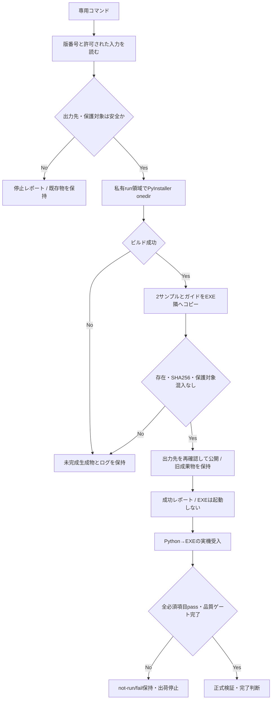

# Phase 06: サンプル配布とリリース検証 - Research

**Researched:** 2026-10-24 JST
**Domain:** Windows 11 / Python / PyInstaller onedir / 非破壊ビルド / 実配布受入
**Confidence:** MEDIUM（公式一次資料と現行コードを確認。実ビルド・テスト・実機受入は本調査では未実施）

<user_constraints>
## User Constraints (from CONTEXT.md)

以下は決定正本の逐語転記。D-01〜16・既存停止条件・技術詳細の裁量・保留事項を変更しない。[VERIFIED: .planning/phases/06-release-validation/06-CONTEXT.md:17-67,139-143]

<!-- DATA_B7F2A9C4_START -->
## 今回確定した実装方針

### サンプルの使い始め方

- **D-01:** 短い日本語の利用ガイドを配布物に同梱し、README にも使い方を記載する。
- **D-02:** OCR 用・サマリ用を別々に説明し、必要な方だけコピーして実利用ファイル名へ変更する。対応は `ocr_custom_prompt_sample.md` → `ocr_custom_prompt.md`、`ocr_summary_prompt_sample.md` → `ocr_summary_prompt.md`。サンプルそのものを実利用ファイルとして上書き編集させない。
- **D-03:** 同梱ガイドは最短手順と注意点に絞る。コピー先・変更後のファイル名・編集方法・既存ファイルを上書きしない注意を含め、詳細は既存ドキュメントへ案内する。
- **D-04:** 同梱ガイドは Markdown（`.md`）形式にする。

### 再ビルド・配布更新時の扱い

- **D-05:** 利用者の標準更新手順は、別フォルダーへ展開し、旧フォルダーを残して設定・実利用プロンプトを新フォルダーへコピーする方法にする。問題時は旧フォルダーの版へ戻れるようにする。
- **D-06:** 保守担当者の再ビルド先に設定や実利用プロンプトがあれば、ビルドを始めず停止する。ファイルの存在を知らせ、別の空フォルダーでのビルドを案内する。検出は削除・置換・ビルド開始より前に行う。この停止による保護も、既存ファイルを置いた非破壊性の検証対象に含める。
- **D-07:** 移行先に同名の設定・実利用プロンプトがあればコピーを止め、内容を確認してから利用者が選ぶ手順を案内する。選択前は両方を保持し、自動上書きしない。新しい自動移行機能を要求する決定ではない。
- **D-08:** 展開後の標準配布フォルダー名に版番号を含める。例は `PageFolio-v1.10.0`。EXE・サンプル・ガイドはその配布構成で参照できるようにする。

### ビルド操作と結果表示

- **D-09:** 専用コマンド1つで、出力先の安全確認、EXE ビルド、2サンプルとガイドの同梱、内容一致の検証まで実行する。同じ手順を初回・再ビルドで利用する。
- **D-10:** 画面には短い成否と出力先を表示し、詳細な検証レポートを保存する。レポートには版番号・同梱ファイル・SHA-256 照合結果を含める。
- **D-11:** ビルドや同梱検証が失敗した生成物は、未完成と分かる形で残す。配布用と区別し、失敗理由・ログとともに調査できるよう保持する。未検証の生成物を成功した配布物として扱わない。
- **D-12:** 成功後は出力先と次の実機確認手順を案内して終了する。生成 EXE は自動起動せず、担当者が準備してから起動する。

### 実機確認の進め方

- **D-13:** 人の操作が必要な確認は少数ずつ区切る。操作と観察点を提示し、結果を受け取ってから次の組へ進む。
- **D-14:** Python 起動と配布 EXE に共通する確認項目は、同じ操作を Python → EXE の順で確認する。Python の両入口、混在、各経路固有のケースも既存要件に従って網羅する。
- **D-15:** 利用者からの回答は「ケース ID＋短い観察結果」とする。例は「W01：最大化状態へ戻った」。異常があれば内容も記録する。短い回答形式を理由に必須観察点や環境情報を省略しない。
- **D-16:** ログ・観察結果に加える画面記録は、通知の表示や DPI など見た目の判定が必要なケースと異常時を中心に残す。その他はログと観察結果を残す。画面記録だけで入力先・foreground・時間上限が実証されたとは判定しない。

### 既存の承認済み要件・停止条件の引継ぎ

以下は今回の16件とは別の、既存資料からの引継ぎ条件である。

- 正本は既存2サンプルの内容を保全してビルド出力先の外にコピーし、元との一致を確認する。初回クリーンビルドと再ビルドの両方で、EXE と同階層への2ファイルの存在と正本との SHA-256 一致を機械確認する。サンプルの内容改稿は今回の決定に含まれない。
- `pagefolio_settings.json` と実利用の `ocr_custom_prompt.md`／`ocr_summary_prompt.md` を、アプリ起動・再ビルド・配布物反映で無断消去・上書きしない。D-06 の停止と D-05/D-07 の案内を、実ファイルを置いた条件で検証する。
- `06-UAT-CARRYOVER.md` の全未実施人手項目をケース ID ごとに計画・UAT・VALIDATION へ割り当てる。W01〜W12 の枝番、別 session、DPI/UAC、実 OS の前面化拒否、操作状態維持、実 EXE/Python 混在を取り落とさない。Phase 4 の WR-01／W07b の時間超過・負荷条件と未分類の観測も正本資料に照合する。
- 全必須人手項目に実測根拠付き pass が揃うまで、Phase 6 完了・v1.10.0 リリースを停止する。準備不能は `not-run` を維持する。別アカウント新設・資格情報取得・mock による別 session 実機合格への置換は行わない。
- 実行担当が一時 PDF・隔離設定・fake OCR・所有 PID の準備と回収を担い、人がクリック・入力・UAC・既存ユーザー切替・目視を行う。対象 commit・OS・Python/Tk・権限・session・入口・観測時刻・判定を記録し、自動・故障注入・実機・未実施を区別する。元の失敗・不採用・時間超過の記録は消さない。
- Phase 4 の完了履歴は維持するが、現行検証報告は stale と記録されているため再検証が必要。Phase 5 の完了済み H01〜H14／意味評価2件を無理由に再実施しない。配布 EXE 固有の新規受入は別途実施する。
- DEP-05-REGRESSION、owner_missing、通知前景不一致、Tcl 警告、未分類 edge の原因は未解除として扱う。成功済み全件テストを根本原因解決・依存解除・出荷承認へ読み替えない。同種失敗の再発時は実装・後続実行・コミットを停止し、最初の失敗出力と専用 basetemp の `result.json`／`traceback.log`、poll／reader／process 診断を保存して該当 `$gsd-debug` を再開する。期限延長・skip・テスト除外で通さない。
- 必須 lint・format・AST・単一プロセス全件 pytest と、フェーズ完了時の `$gsd-validate-phase` を維持する。同一コード・入力・環境の成功済み検証は同一性を照合して再利用し、製品・入力・環境の変更後は必要な検証を実施する。
- 実装時に `pagefolio/constants.py` の `APP_VERSION` を真の情報源として v1.10.0 へ更新し、README バッジ・開発履歴と同期する。未対応旧版と OS 前面化制約も説明する。議論時点のコードは `v1.9.1` であり、本書作成では変更しない。

### 調査・計画で決める技術詳細

ユーザーから決定事項の一括委任はない。上記の確定方針と既存要件を守る範囲で、正本の配置パス、ガイド名、専用コマンドの実装言語・引数、PyInstaller 設定の管理方法、作業先と版番号付き配布先の構成、レポート形式・保存先・失敗物の識別方法は調査・計画で具体化する。

ガイド内の参照は、配布物だけを受け取った人にも辿れるようにする。初回・再ビルドの手順を一本化し、版番号を手動で重複管理しない具体策を検討する。これらは本書で方式を採用したという意味ではない。

## 保留事項

議論中の新規追加要望はない。起動 PDF 引数転送、最近使ったファイル・閲覧位置の復元、異常終了後の編集復旧、外部プロンプト保存失敗通知、OCR 共通化、技術的負債の一括解消、実 API UAT、自動更新機構、汎用設定復旧ツールは引き続き範囲外。
<!-- DATA_B7F2A9C4_END -->
</user_constraints>

## Summary

既存の開発ガイドは、PyInstaller が出力先を再作成する前にサンプルを一時退避し、後で復元する手順である。専用コマンドへ置き換え、正本を出力外へ**バイト列のままコピー**して Git 管理し、ビルド前の利用者ファイル検出、隔離ビルド、同梱検証、検証済み生成物の公開を分ける。公式資料でも `--noconfirm` は出力先を確認なしで置換する指定であり、利用者ファイルの保護機能ではない。[VERIFIED: docs/DEVELOPMENT.md:65-103] [CITED: https://pyinstaller.org/en/stable/usage.html]

新しい外部依存を加えず、既存 Python と PyInstaller を使う案を推奨する。ビルドの成功とリリース承認を別の結果として記録する。Phase 5 の人手受入は再利用する一方、実 EXE 統合、全 W 枝番、WR-01、Phase 4 の検証鮮度は別のゲートとして計画する。現行記録の引用は「Phase 04報告はstale」「DEP-05・owner_missing・通知前景不一致・Tcl警告・未分類edge4件は未解除」。[ASSUMED: A1 実装案] [VERIFIED: .planning/STATE.md:56-58]

**Primary recommendation:** 標準ライブラリ製の単一ビルド入口で、保護検査→私有作業先→同梱/SHA-256照合→検証済み配布先への昇格を行う。失敗した作業先と既存配布物を保持し、EXE は自動起動しない。[ASSUMED: A1] [VERIFIED: .planning/phases/06-release-validation/06-CONTEXT.md:29-39]

## Architectural Responsibility Map

以下は計画上の責務割当案であり、Web のクライアント/サーバー構成を新設しない。[ASSUMED: A1]

| Capability | Primary Tier | Secondary Tier | Rationale |
|---|---|---|---|
| 版番号・正本・ガイドの管理 | ソース管理 | ビルドツール | ソースを配布出力の再作成から隔離する |
| preflight・ビルド・ハッシュ照合・レポート | 開発者向け CLI | ファイルシステム / PyInstaller | 製品 UI にビルド責務を持たせない |
| 設定・実利用プロンプトの解決 | 既存デスクトップアプリ | EXE 同階層ストレージ | 既存の読み書き契約を維持する |
| 更新時のコピー選択 | 利用者の操作 / ガイド | ファイルシステム | 自動移行機構は追加しない |
| Python/EXE の観測・隔離準備 | 検証ハーネス | Win32 / Tk | 実行担当が準備し、人が実入力・UAC・目視を担当する |
| 最終受入・出荷判断 | GSD 証跡 / 人手判定 | 自動品質ゲート | ビルド成功だけで出荷可能にしない |

## Project Constraints (from AGENTS.md)

- 日本語で説明・文書・コミット・申し送りを作る。GSD の認可された作業内で編集し、1タスクずつ完了する。[VERIFIED: AGENTS.md:49-76,158-168]
- Python 変更時の必須コマンドは「`ruff check . && ruff format .`」、コミット前は「`pytest`」。構文確認・開発履歴・版番号同期も必要。今回の調査では実装・実ビルド・テスト・コミットを行わず、実行計画へ引き継ぐ。[VERIFIED: AGENTS.md:51-59,105-114]
- 「`pyproject.toml` の編集」「裸の `except:`」「`# type: ignore` の無断使用」は禁止。[VERIFIED: AGENTS.md:55-59]
- 既存パッケージ/Mixin 構成を維持する。内部メソッドは `_`、テーマは `C["BG_DARK"]` 等、フォントは `self._font(delta)`。ボタン値は「`"TButton"`」「`"Accent.TButton"`」「`"Danger.TButton"`」「`"CropOn.TButton"`」。[VERIFIED: AGENTS.md:29-39]
- ページ変更後は `self._refresh_all()`、操作完了は `self._set_status(msg)`、ファイル操作前は `self._check_doc()`。CropBox は MediaBox 内へ clamp。既存設定保存を維持する。[VERIFIED: AGENTS.md:41-47]
- UI 操作は Tk メインスレッド。OCR ワーカーへ fitz.Document を共有しない。Undo は `_capture_page_blob(page_i)` / `_blob_bytes(data)` と既存の解放経路を使い、スタックの直接 `append` / `clear` を禁止する。[VERIFIED: AGENTS.md:144-148] [CITED: pagefolio/CLAUDE.md]
- API キーの非永続化と registry の標準ライブラリのみの独立性を維持する。配布物・レポートへ設定本文や環境変数を収集しない。[VERIFIED: AGENTS.md:99-100] [VERIFIED: pagefolio/settings.py:26-30,352-365]
- 版番号の真の情報源は `APP_VERSION`。今回確認した定義は「`APP_VERSION = "v1.9.1"`」。実装時に承認済みの v1.10.0 と README/履歴を同期する。[VERIFIED: pagefolio/constants.py:11-12] [VERIFIED: .planning/phases/06-release-validation/06-CONTEXT.md:60-66]
- 最終申し送りは session-handoff スキルの日本語書式に従う。[CITED: .agents/skills/session-handoff/SKILL.md]

<phase_requirements>
## Phase Requirements

要件文は正本から逐語転記。[VERIFIED: .planning/REQUIREMENTS.md:52-60]

<!-- DATA_C3D8E1A6_START -->
| ID | Description | Research Support |
|---|---|---|
| V110-DIST-01 | 配布担当者は2種のサンプルプロンプトの正本をビルド出力先の外でソース管理でき、出力先の再作成で正本を失わない。 | 出力外へのバイトコピー・SHA-256・既存サンプル維持 |
| V110-DIST-02 | 配布担当者は文書化した同じビルド手順を初回・再ビルドで実行し、2サンプルが配布 EXE と同階層に存在して正本と内容一致することを機械確認できる。利用者は配布サンプルを既存の外部プロンプト利用手順で使用できる。 | 単一CLI・私有出力・後処理コピー・ガイド |
| V110-DIST-03 | 利用者が編集した設定・実利用プロンプトは、アプリ起動や再ビルド・配布物の反映によって無断で消去・上書きされない。 | 最初のpreflight・公開前再確認・競合時停止・実ファイルfixture |
| V110-QA-01 | 保守担当者は起動競合・初期化失敗・設定 I/O 障害・同梱不備を自動テストで再現でき、プロジェクト必須の lint・format・構文確認・全テストを合格させられる。 | 既存回帰＋ビルド障害注入＋単一全件ゲート |
| V110-QA-02 | 検証担当者は Windows 11 の Python 各起動経路と実配布 EXE で、起動・画面復帰・設定通知・同梱の受入結果を確認し、未実施項目を合格と混同せず記録できる。 | W全枝番・実EXE adapter・既存H再利用・実測記録 |
| V110-QA-03 | 利用者はアプリ・README・開発履歴から整合した v1.10.0 の版番号と変更内容、未対応旧版・OS 前面化制約の説明を確認できる。 | AST版読取・文書同期・GUI版確認・保証範囲 |
<!-- DATA_C3D8E1A6_END -->
</phase_requirements>

## Standard Stack

新規パッケージ導入や依存更新は計画しない。以下は実在する既存環境の継続利用であり、ビルド成果物の互換性を実証したという意味ではない。[ASSUMED: A1]

| Library / tool | 確認版 | 用途 | 根拠 |
|---|---|---|---|
| Python | 3.15.1 | 専用CLI・既存アプリ・標準ライブラリ | [VERIFIED: 2026-10-24 `.venv/Scripts/python.exe --version`] |
| `pyinstaller` [WARNING: flagged as suspicious — verify before using.] | 6.22.3 | Windows onedir | 定義「`pyinstaller==6.22.3`」[VERIFIED: requirements.txt:5]。公式版とPyPIの最新/installed一致。[CITED: https://pyinstaller.org/en/stable/] |
| pytest | 9.1.1 | 既存試験基盤 | 定義「`pytest==9.1.1`」[VERIFIED: requirements.txt:8]。`pip show`で導入版一致 |
| Ruff | 0.17.1 | 必須 lint/format | 定義「`ruff==0.17.1`」[VERIFIED: requirements.txt:10]。`pip show`で導入版一致 |
| Python標準 `pathlib` / `subprocess` / `hashlib` / `json` / `ast` | 上記Python付属 | 絶対パス・子プロセス・SHA-256・レポート・版番号読取 | [CITED: https://docs.python.org/3/library/pathlib.html] [CITED: https://docs.python.org/3/library/subprocess.html] [CITED: https://docs.python.org/3/library/hashlib.html] |
| 既存 PyInstaller hooks | pyinstaller-hooks-contrib 2026.9 | 既存依存収集 | [VERIFIED: 2026-10-24 importlib.metadata.version 読取]。本番ビルドログで実使用hookを別途確認 |

**版・公開日の確認:** PyPI読み取りコマンド `.venv/Scripts/python.exe -m pip index versions pyinstaller` は `INSTALLED: 6.22.3 / LATEST: 6.22.3`。公式 changelog は 2026-09-12 公開、legitimacy seam は `publishedAt: 2026-09-12T21:53:01.711695Z`。Python 3.15 は 6.21.0、Tcl/Tk 9 embedded data の対応は 6.22.0 で明示されている。したがってメタデータ欠落から「3.15非対応」と判断しない。[VERIFIED: 2026-10-24 pip index versions / package-legitimacy 実行結果] [CITED: https://pyinstaller.org/en/stable/CHANGES.html]

**Installation:** 既存環境を使うため通常経路のインストールコマンドは不要。新環境構築が必要になった場合だけ、既存 requirements の採用版・真正性確認後に再構築する。未承認の更新をビルドコマンドへ内蔵しない。[ASSUMED: A1]

### Alternatives Considered

| 選択 | 採用理由 / 不採用理由 |
|---|---|
| Python CLI + 毎回生成spec + build後コピー | 推奨。既存pytestで安全境界を試験しやすく、初回・再ビルドの差をなくせる。[ASSUMED: A1] |
| 手編集した永続spec | 複雑な追加収集が判明した場合の選択肢。specは実行可能Pythonで、spec入力時は多くのCLI指定が無視されるため、設定の二重管理を避ける。[CITED: https://pyinstaller.org/en/stable/spec-files.html] |
| `--add-data`だけで外部サンプルを配置 | onedirのsupporting filesとEXE同階層を混同しやすい。外部利用ファイルは後処理でEXEの隣へ明示コピーする案を採用する。[CITED: https://pyinstaller.org/en/stable/runtime-information.html] [ASSUMED: A1] |
| onefile / 自動更新 / 自動移行 | 確定範囲外。onedirと手動コピーを維持する。[VERIFIED: .planning/phases/06-release-validation/06-CONTEXT.md:27-39,119-122,139-143] |

## Package Legitimacy Audit

今回は既存依存を使い、新規導入を要求しない。それでもPyInstallerを確認した結果は下表。最初のsandbox内照会では情報取得できず、権限を付けた読み取り再照会で存在・公開日時・URLを取得した。取得失敗を「パッケージ不存在」へ読み替えない。[VERIFIED: 2026-10-24 package-legitimacy / pip index 実行結果]

| Package | Registry | 公開日時 / Downloads | Source Repo / URL | Verdict | Disposition |
|---|---|---|---|---|---|
| `pyinstaller` [WARNING: flagged as suspicious — verify before using.] | PyPI | 2026-09-12T21:53:01.711695Z / null | seam: https://pyinstaller.org | SUS: `unknown-downloads` | 既存導入を保持。新規installを計画する場合は `checkpoint:human-verify` を置く |

公式 PyInstaller マニュアルから PyPI への導線も確認したが、seam が OK ではないため「VERIFIED: npm registry」等のタグを付けない。SLOPで除去したパッケージはない。Node.js の postinstall 検査は本Python依存には適用しない。[CITED: https://www.pyinstaller.org/en/stable/] [VERIFIED: 2026-10-24 package-legitimacy 実行結果]

## Architecture Patterns

### System Architecture Diagram

以下は実装提案。[ASSUMED: A1]



### Recommended Project Structure / Component Responsibilities

**以下のパスは新規提案であり、既存ファイルの存在を主張しない。計画で確定する。**[ASSUMED: A1]

| 提案パス | 責務 |
|---|---|
| `distribution/samples/ocr_custom_prompt_sample.md` | 既存OCRサンプルのバイトコピー正本 |
| `distribution/samples/ocr_summary_prompt_sample.md` | 既存サマリサンプルのバイトコピー正本 |
| `distribution/はじめに.md` | 日本語の最短利用・更新・衝突時停止ガイド |
| `tools/build_release.py` | 単一CLI。純関数のpreflight/版読取/hashと副作用のbuild/publishを分離 |
| `tests/test_release_build.py` | tmp_pathとfake builderによる安全性/失敗保持テスト |
| `tests/test_release_contract.py` | 版・文書・正本・ガイド・受入ID被覆の契約 |
| `tests/release_uat_support.py` | 実EXE観測/作業コピー準備/原本照合の試験専用支援 |
| `dist/.release-work/<run-id>/` | 所有者が分かる私有run、work/spec/stage/log/report、失敗保持 |
| `dist/PageFolio-<APP_VERSION>/` | 検証成功後だけ公開する標準配布フォルダー |
| `dist/.release-history/<run-id>/` | 再ビルド前の検証済み旧成果物の保持先 |

既存配布物には `git ls-files dist` で975件の追跡物が観測された。後発のignore行は「`dist/`」で、先行する「`dist/*`」「`!dist/PageFolio`」「`!dist/PageFolio/**`」と併存する。追跡済みファイルと新規ignoreの扱いを分け、旧配布物を削除したり全distをstageしたりしない。[VERIFIED: .gitignore:9-14,68-74] [VERIFIED: 2026-10-24 git ls-files dist]

### Pattern 1: 正本を保存してから出力を作る

元の2サンプルは本調査で読み取り・SHA-256確認だけを行った。実装時はテキストのread/writeや改行正規化をせずコピーし、旧ファイル→新正本→初回配布→再配布の各段階で比較する。[ASSUMED: A1] [VERIFIED: .planning/phases/06-release-validation/06-CONTEXT.md:52]

| 調査で読んだ元ファイル（生成経路は未確認、現在の存在はread/hashで確認） | 調査時SHA-256 |
|---|---|
| `dist/PageFolio/ocr_custom_prompt_sample.md` | `03EC2D06B184282974D32BE00F228BC37126C79B58AA9EC6E5FC38633E648E5D` |
| `dist/PageFolio/ocr_summary_prompt_sample.md` | `6960CB29B8B65B9823A2C48011316AE83DBEC32331D2AB63260F910CE2C08B55` |

上表はGet-FileHashの観測値であり、将来作成する正本パスの生成済み証拠ではない。[VERIFIED: 2026-10-24 Get-FileHash / サンプル本文読取]

### Pattern 2: 副作用前のpreflightと私有出力

保護対象の定義を手で重複させず、定数から読む。開いたソースの原文は次のとおり。[VERIFIED: pagefolio/constants.py:15-22]

<!-- DATA_E7A2F4B9_START -->
```python
SETTINGS_FILE = "pagefolio_settings.json"
CUSTOM_PROMPT_FILE = "ocr_custom_prompt.md"
SUMMARY_PROMPT_FILE = "ocr_summary_prompt.md"
```
<!-- DATA_E7A2F4B9_END -->

実装計画には次の順序を明示する。[ASSUMED: A1]

1. ルートと出力先を絶対パスへ解決し、ソース、正本、旧配布、ドライブルート、親子重複、symlink/junctionを検査する。対象不明・権限で調査不能なら停止する。
2. 出力先に保護対象3名があれば**PyInstaller起動・削除・移動・置換の前**に非zero終了し、別の空フォルダーを案内する。通常ファイルだけでなく同名ディレクトリ・broken linkも衝突として止める。
3. 同じ出力先への同時実行は排他的な所有記録で防ぐ。既存先は空、または前回レポートで所有範囲が明確な未変更配布物のみ再ビルド対象とし、未知ファイルがあれば止める。
4. 別の私有run領域へwork/spec/distを指定する。前のrunは再利用せず、失敗物を消す `TemporaryDirectory` の自動cleanupを使わない。
5. コピー後はEXE・2サンプル・ガイド、サンプルSHA、実利用ファイル混入なしを検査する。ログと詳細レポートが書けない場合も成功にしない。
6. 公開直前にも保護対象と所有記録を再検査する。旧出力を残して昇格し、失敗時は旧出力を復帰させる。複数renameは一括atomic transactionではないので、各段階の状態と復旧可能なパスを記録する。
7. 公開後の検査まで完了して初めて成功表示する。EXEを自動起動しない。

私有出力を指定しても、D-06の対象である最終出力先を無視してビルドを始めてはいけない。危険な置換オプションへ利用者フォルダーを直接渡す設計は採用しない。[VERIFIED: .planning/phases/06-release-validation/06-CONTEXT.md:30-39] [CITED: https://pyinstaller.org/en/stable/usage.html]

### Pattern 3: 外部ファイルとbundle内資源を区別する

frozen時の既存基準は原文「`return os.path.dirname(sys.executable)`」、通常時は「`return os.path.dirname(os.path.dirname(os.path.abspath(__file__)))`」。プロンプト書込みは「`path = os.path.join(_get_base_dir(), filename)`」→「`with open(path, "w", encoding="utf-8") as f:`」である。したがって配布サンプルをEXE同階層へ置く判断は現行の実利用ファイル解決と整合する。[VERIFIED: pagefolio/settings.py:33-50,85-101]

PyInstallerのonedirでは `sys._MEIPASS` はsupporting files側を指し、`sys.executable` は実際のEXEを指す。後処理コピーはこの区別を保つための提案である。[CITED: https://pyinstaller.org/en/stable/runtime-information.html] [ASSUMED: A1]

ガイドにはOCR/サマリ各コピー名、既存先がある場合の停止、外部エディタ編集、設定Applyによる書戻し、別フォルダー更新と旧版保持を記す。詳細リンクは配布物だけから辿れる固定URL、または同梱した文書を使い、存在しない相対リンクを置かない。[VERIFIED: .planning/phases/06-release-validation/06-CONTEXT.md:22-31,66] [CITED: docs/CONFIGURATION.md:114-125]

### Pattern 4: 版番号とレポートの単一情報源

`APP_VERSION` の文字列リテラルをASTで読み、フォルダー名・レポート・文書検査へ渡す案を推奨する。ビルドのためにアプリを起動しない。定義は前掲の「`APP_VERSION = "v1.9.1"`」、READMEの現状は「`https://img.shields.io/badge/version-v1.9.1-blue`」。先にv1.10.0へ同期してからビルドし、後で版番号だけを変えたEXEを出荷しない。[ASSUMED: A1] [VERIFIED: pagefolio/constants.py:12] [VERIFIED: README.md:7]

レポートにはrun ID、版、対象commitとdirty状態、入力ファイルhash、Python/PyInstaller/hook版、開始終了時刻、実コマンド、終了コード、stageと最終先、同梱一覧、SHA期待値/実値、失敗段階/例外種別、旧出力/失敗物の保持先を記録する。利用者設定本文・APIキー・環境全dumpは記録しない。ビルド検証成功と「実機UAT未完了」を別フィールドにする。[ASSUMED: A2]

## Don't Hand-Roll

| 問題 | 作らないもの | 利用するもの | 根拠 |
|---|---|---|---|
| Python/Native DLL/Tkのbundle | 独自収集器 | 既存PyInstallerとhooks、実EXE検証 | [CITED: https://pyinstaller.org/en/stable/] |
| SHA-256 | 自作hash | 標準 `hashlib.sha256` | [CITED: https://docs.python.org/3/library/hashlib.html] |
| shell文字列の組立 | 空白パスを文字列連結したcmd | `subprocess.run` の引数列、`shell=False` | [CITED: https://docs.python.org/3/library/subprocess.html] |
| EXE外部ファイル解決 | 新しい設定保存先 | 既存 `_get_base_dir()` | [VERIFIED: pagefolio/settings.py:33-50] |
| 利用者の自動移行 | updater/merge機能 | D-05/D-07の手順と手動選択 | [VERIFIED: .planning/phases/06-release-validation/06-CONTEXT.md:29-31] |
| Win32入力/排他の再実装 | 配布専用の別ロック | 既存製品経路と観測ハーネス | [ASSUMED: A3] |

## Runtime State Inventory

サンプル正本の追加コピーと版付き出力への移行として棚卸しする。アプリ識別子や利用者の保存先を改名する計画ではない。[VERIFIED: .planning/phases/06-release-validation/06-CONTEXT.md:52-66]

| Category | Items Found / 観測範囲 | Action Required |
|---|---|---|
| Stored data | 既存設定・実利用プロンプトはEXE隣に書かれる。定数名と生成処理は前掲引用を参照。[VERIFIED: pagefolio/settings.py:85-101,369-381] | 自動data migrationなし。利用者のコピー手順・衝突時両方保持を試験する |
| Live service config | 外部サービスの現況は未調査。Phase範囲に外部サービス改名/移行はない。[ASSUMED: A4] | 実API設定・資格情報を変更しない |
| OS-registered state | Task Scheduler等の列挙は未実施。ExplorerショートカットとUAC/sessionは受入対象。[VERIFIED: .planning/phases/04-startup-control/04-WINDOWS-UAT.md:70-75] | 配布フォルダー変更後の起動先を手順で確認。名前付き排他は現行製品に任せる |
| Secrets/env vars | 機密キーは保存時除外するコードがある。[VERIFIED: pagefolio/settings.py:352-365] | 値や.envを配布へcopyしない。env名の変更・移行なし |
| Build artifacts | 旧dist追跡物975件、正本候補は既存2サンプル。ルートのspec/buildスクリプト列挙では一致なし。[VERIFIED: 2026-10-24 git ls-files / Get-ChildItem] | 旧distを保持し、新しい作業先を使用。生成specを正本にしない |

## Common Pitfalls

- **出力先にあるサンプルを唯一の正本にする:** 再ビルドで消える構造を残す。最初に出力外へcopy/hashし、元サンプルは残す。[VERIFIED: docs/DEVELOPMENT.md:85-103]
- **`--name=PageFolio-v1.10.0`で版付きフォルダーを作る:** EXE名にも影響する。CLIではアプリ名を維持し、検証済みbundleを版付き配布先へ配置する。[CITED: https://pyinstaller.org/en/stable/usage.html] [ASSUMED: A1]
- **ハッシュ一致だけで「再現可能なEXE」と言う:** 必須なのはサンプルの一致と同手順の再実行。全EXEのbit-for-bit再現性はこの要件にない。[VERIFIED: .planning/REQUIREMENTS.md:52-54,82-86]
- **正常終了時の設定保存まで不変を要求する:** 起動の非破壊性と、明示Apply/終了時の正当な保存を分ける。起動直後のsnapshotと保存操作後の期待差分を分けて判定する。[VERIFIED: pagefolio/settings.py:309-320,369-381] [CITED: docs/CONFIGURATION.md:17-26]
- **最新の証拠JSONだけでPhase状態を決める:** JSON末尾に「`"status": "human_needed"`」「`"pending_explicit_prohibition_judgments": 2`」の履歴が残る。一方、正式報告は「`status: passed`」、最終UATは「`result: pass`」2件。項目・時刻・正本を照合する。[VERIFIED: .planning/phases/05-config-notification/05-EVIDENCE.json:567-576] [VERIFIED: .planning/phases/05-config-notification/05-VERIFICATION.md:1-5] [VERIFIED: .planning/phases/05-config-notification/05-UAT.md:71-94]
- **Phase4報告の過去passを現在の鮮度へ外挿する:** frontmatterは「`status: passed`」だが、現行STATEは「Phase 04報告はstale」。完了履歴と現在の再検証要求を両方残す。[VERIFIED: .planning/phases/04-startup-control/04-VERIFICATION.md:1-5] [VERIFIED: .planning/STATE.md:56]
- **full suite成功で原因解除:** DEP-05・owner_missing・通知前景不一致は未確定。再発時は最初の証拠を保全し、後続実行/コミットを止める。[VERIFIED: .planning/STATE.md:56-58] [VERIFIED: .planning/debug/simultaneous-owner-missing.md:8-28]

## Code Examples

次は標準APIに基づく**未実装の骨格**である。変数はpreflight済みの絶対パスを受け取り、既存製品APIの新しい引数や戻り値を仮定しない。[ASSUMED: A1]

```python
# Source: https://docs.python.org/3/library/hashlib.html
# Source: https://docs.python.org/3/library/subprocess.html
import hashlib
import subprocess

def _sha256(path):
    return hashlib.sha256(path.read_bytes()).hexdigest()

# args は固定オプションと検証済みパスから作った list[str]。
# builder の起動前に最終出力先の保護検査を完了させる。
completed = subprocess.run(
    args,
    cwd=repo_root,
    stdout=build_log,
    stderr=subprocess.STDOUT,
    shell=False,
    check=False,
)
if completed.returncode:
    # この経路で stage を削除しない。失敗段階と終了コードを保存する。
    record_failure(completed.returncode)
```

内部builderは現在のPythonに対する `-m PyInstaller`、onedir、noconsole、固定アプリ名、icon、私有dist/work/spec先、絶対entryを引数列にする。spec再入力との二重設定を避ける。全パスをsource treeから独立に算出することで、起動cwdに依存しない。[CITED: https://pyinstaller.org/en/stable/usage.html] [CITED: https://pyinstaller.org/en/stable/spec-files.html] [ASSUMED: A1]

## State of the Art

| 既存/過去方式 | 今回の方針 | 根拠 / 影響 |
|---|---|---|
| dist唯一のサンプル→手動退避 | 出力外の正本＋同梱hash検証 | 現行ガイドを置換する。[VERIFIED: docs/DEVELOPMENT.md:85-103] |
| 旧onedirで全資源同階層を仮定 | EXEとsupporting filesを区別 | 外部サンプルはEXE隣へ。[CITED: https://pyinstaller.org/en/stable/runtime-information.html] |
| 古いPython対応情報から推測 | 6.21.0/6.22.0の明示対応を参照 | Python3.15/Tk9を根拠なく降格しない。[CITED: https://pyinstaller.org/en/stable/CHANGES.html] |
| 全件成功＝全受入完了 | 自動・故障注入・人手・not-runを分離 | Phase6に全必須W受入を残す。[VERIFIED: .planning/phases/06-release-validation/06-UAT-CARRYOVER.md:30-38] |

## Environment Availability

| Dependency | Required By | Available | Version / 観測 | Fallback |
|---|---|---|---|---|
| Windows Python | ビルド/試験 | あり | win32 / Python3.15.1 [VERIFIED: 2026-10-24 metadata probe] | OS更新・別Pythonへの無断変更なし |
| PyInstaller | onedir | 導入済み | 6.22.3 [VERIFIED: pip show / pip index] | 再導入が必要ならSUS確認ゲート |
| Tk | 実機GUI | import可能 | TkVersion 9.0。GUI生成は未実施 [VERIFIED: 2026-10-24 tkinter metadata probe] | 起動可否は実EXE受入で判定 |
| pytest / Ruff | 品質ゲート | 導入済み | 9.1.1 / 0.17.1 [VERIFIED: pip show] | 同一環境の証拠再利用条件を照合 |
| Context7 MCP / ctx7 | 文書調査 | 利用不可 | tool inventory該当なし / Get-Command一致なし [VERIFIED: 2026-10-24 inventory] | 公式Web資料で代替済み |
| 既存別Windows session | W11 | 準備不能の記録 | 「not-run（別アカウント準備不能）」[VERIFIED: .planning/phases/06-release-validation/06-UAT-CARRYOVER.md:26] | mock代替なし。用意できるまで出荷停止 |
| 実配布EXEと専用adapter | 新規EXE受入 | 今回未作成 | 元harnessのentryは下記引用参照 | 実装/ビルド後に段階実施 |

不足のうちW11はリリースを止めるが、調査・実装計画の作成までは進められる。アカウント新設や資格情報取得を解決策にしない。[VERIFIED: .planning/phases/06-release-validation/06-CONTEXT.md:54-59]

## Validation Architecture

config原文は「`"nyquist_validation": true`」「`"security_enforcement": true`」。本節は必須。本調査中にテストは実行していない。[VERIFIED: .planning/config.json:20,42-44]

### Test Framework

| Property | Value |
|---|---|
| Framework | 既存pytest 9.1.1。新規フレームワーク不要。[VERIFIED: requirements.txt:8] |
| Config file | `pyproject.toml`、原文「`testpaths = ["tests"]`」。編集禁止。[VERIFIED: pyproject.toml:11-13] |
| Quick run command（提案） | `.venv/Scripts/python.exe -m pytest -q tests/test_release_build.py`。純粋/一時ディレクトリ試験を30秒以内目標に分離。[ASSUMED: A3] |
| Full suite command（提案） | `.venv/Scripts/python.exe -m pytest -x -q --tb=short --basetemp=<未使用のrepo外専用絶対パス>`。実行ごとに新しい場所を選ぶ。[ASSUMED: A3] |
| 既存成功基準 | 「`"passed": 1797`」「`"failed": 0`」「`"errors": 0`」「`"warnings": 1`」「`"pytest_seconds": 266.81`」「`"input_files": 103`」。現在の新規変更への保証ではない。[VERIFIED: .planning/phases/05-config-notification/05-EVIDENCE.json:521-550] |

### Phase Requirements → Test Map

提案の新規ファイル・コマンドは未実装。実PyInstallerはfake builderの成功で代替しない。[ASSUMED: A3]

| Req ID | Behavior | Test Type | Automated Command / 確認方法 | File Exists? |
|---|---|---|---|---|
| V110-DIST-01 | 旧サンプル→正本のバイト一致・追跡・出力から独立 | 契約 | pytest tests/test_release_contract.py -q | Wave0新設 |
| V110-DIST-02 | 初回/再ビルド・EXE隣・2SHA一致・ガイド | unit + actual build | pytest tests/test_release_build.py -q ＋専用CLIを初回/再ビルド各1回 | Wave0新設 |
| V110-DIST-03 | 3保護名ごとの事前停止・subprocess未呼出・前後hash/存在一致・更新コピー競合 | unit + integration + 人手 | 同上＋隔離実EXEの起動前後snapshot＋ガイド通りの別フォルダー更新 | Wave0新設 |
| V110-QA-01 | build非zero・欠落・hash不一致・copy失敗・report失敗・publish失敗・同時実行 | 障害注入 | pytest tests/test_release_build.py -q ＋既存startup/config全件回帰 | 新規＋既存 |
| V110-QA-02 | Python/EXE入口・状態・実入力・OS拒否・DPI/UAC/session | 自動観測＋manual | 既存harnessは下記契約、実EXEは別adapterを作成。W全ID表を使用 | Python既存 / EXEはWave0 |
| V110-QA-03 | APP_VERSION・README・履歴・folder/report一致・保証範囲 | 契約＋GUI | pytest tests/test_release_contract.py -q ＋配布GUIの版確認 | Wave0新設 |

unitテストの最低境界は、出力先不正、空先成功、管理済み再ビルド、利用者3ファイルそれぞれ存在、出力先読取不能、リンク/同名ディレクトリ、未知ファイル、build中の出力先変化、同梱欠落/改変、公開途中失敗、レポート書込失敗。同じ文字列を実装からコピーしてassertするだけの試験にせず、実ファイルの前後不変とbuilderの未呼出/一回呼出、失敗物の存在を観測する。[ASSUMED: A3]

### Wケースの全件引受表

下表のIDと未実施は移管正本、細分操作は04-WINDOWS-UATを使用。**全て人手部分は未実施から開始する。** Pythonの両入口・別配置・実EXE/対応版混在の軸とケースを別々の列で追跡し、まとめてpassを付けない。枝番24ケースにWR-01を追加追跡する。[VERIFIED: .planning/phases/06-release-validation/06-UAT-CARRYOVER.md:14-38] [VERIFIED: .planning/phases/04-startup-control/04-WINDOWS-UAT.md:50-75]

| ID（原文） | 必須観測 / 計画割当 |
|---|---|
| W01 | normal/zoomedから最小化復帰、state/geometry/status |
| W02 | settings/thumb/previewの実入力・選択・カーソル・操作先 |
| W03 | 未保存PDFとUndo→Redo→Undo→Redoの内容/履歴 |
| W04 | fake OCRの進捗・完了・同じ処理/状態の維持 |
| W05a | 入れ子設定、子閉鎖後の外側入力/selection |
| W05b | OCR所有native messageboxを人が閉じる |
| W05c | 終了確認Noで編集と排他を維持 |
| W06 | 他process入力中の実OS拒否、有限点滅、15秒後も再前面化なし |
| W07a | slowready、5秒失効・10秒案内・遅延復帰なし |
| W07b | busy、期限切れqueue副作用なし、負荷予算の再評価 |
| W08a | 初期化死亡後の同時claim、新一次1つ、1回引継ぎ |
| W08b | 正常/強制/初期化例外/公開前例外後の再起動 |
| W08c | No時のmutex、Yes後の独立起動 |
| W08d | root消失、旧worker生存、released、古mapping、同時claimとOS死亡を区別 |
| W09a | 新通知のクリック/他process入力非干渉/10秒自動終了/集約期限/閉鎖後残留なし |
| W09b | 100%実DPI |
| W09c | 150%実DPI |
| W09d | 200%実DPI |
| W10a | medium一次→elevated二次、owner/mapping/双方向pipe/新notice、実UAC |
| W10b | elevated一次→medium二次、同上逆順、identity記録 |
| W11 | 別既存session各1画面、同session復帰と元状態保持。準備不能はnot-run |
| W12a | script/module/別配置の一次・二次3×3 |
| W12b | 実PyInstaller EXEとPython/対応版の混在。identity単体は実EXE試験ではない |
| W12c | Explorer/端末の実入力・foregroundとAPI戻り値を分ける |
| WR-01 | W07bの負荷条件と15.5秒契約適合性を再評価、超過履歴を保持 |

**時間超過を隠さない:** 原文「並行負荷15609ms（15.5秒上限を109ms超過）と単独15140msを両方保持」。並行試験を止めた単独成功を任意負荷の保証へ転用しない。Phase4禁止事項の値は「`flagged_prohibitions: 3`」「`unclassified_edges: 5`」。Phase5の4edgeとは別集合。[VERIFIED: .planning/phases/06-release-validation/06-UAT-CARRYOVER.md:36-38] [VERIFIED: .planning/phases/04-startup-control/04-VERIFICATION.md:18-19]

### 実EXE受入の接点と不足

現harnessの原文は「`choices=["script", "module", "relocated"]`」、操作は「`choices=["start", "peer", "notice", "inspect", "stop"]`」。**`--entry exe` は存在しないので、そのまま実行する計画を作らない。** run生成は「`tempfile.mkdtemp(prefix="pagefolio-uat-", dir=_ROOT / ".planning" / "tmp")`」である。[VERIFIED: tests/test_startup_windows.py:2752-2783,2801-2804]

実装案は、配布EXEの検証済みhashを固定し、その完全コピーを新しい試験フォルダーへ配置して、外側のPython/Win32ハーネスがPID・window・foreground・時刻・存在/hashを観測する方式。Pythonからのmonkeypatchがfrozen EXEへ届くとは仮定しない。製品CLIへ試験専用引数を追加しない。[ASSUMED: A3]

設定障害は使い捨て配布コピーで破損JSONや専有ファイルロック等を準備する案とし、実利用ディレクトリのACLは変更しない。fake OCRはPythonの既存fixtureを利用し、EXE側で必要ならloopback fake service等の具体接続経路を別途実証する。故障注入専用ビルドを作る場合は配布EXEと別hash・別種の証拠にし、本番EXE実機passへ転用しない。[ASSUMED: A3]

### Phase5の再利用と既知ゲート

- H01〜H12、追加H13/H14、および意味評価Test1/2は既にpass。無理由な一括やり直しを計画しない。EXE固有の設定通知受入は新しいID/証拠として追加する。[VERIFIED: .planning/phases/05-config-notification/05-UAT.md:27-49,71-94]
- 103入力hashのmanifestと最新全件結果を再利用する場合、対象ファイルだけでなく入力・環境も照合する。新しい版/コード/テスト/依存・ビルド環境を変えた場合は必要な検証を行う。[VERIFIED: .planning/phases/05-config-notification/05-EVIDENCE.json:521-550] [VERIFIED: .planning/phases/05-config-notification/05-VALIDATION.md:26-42]
- Phase4のstale更新は親ワークフローの `$gsd-execute-phase 04` による再検証を明示的な前提とする。Phase5の合格だけでは置換しない。[VERIFIED: .planning/STATE.md:56,319]
- DoD検査が読む進捗値は原文「`{"Planned", "Not started", "In Progress", "Complete"}`」。未完了Phaseを完了にして検証文書を先に偽装しない。[VERIFIED: tests/test_gsd_dod.py:146-228]

### Sampling Rate

- 各実装タスクは新規局所試験を先に整備して実行する。Python編集後はRuff→Python対象format→再lint→AST。コミット前/各wave末は単一全件pytestの成功または同一条件の成功証拠を照合する。[VERIFIED: .planning/phases/05-config-notification/05-VALIDATION.md:26-42]
- GUI/Win32試験は全件を単一プロセスで行い、共有foregroundを競合させる並列runを組まない案とする。再発したら実装・後続実行・コミットを停止し、初回出力・result.json・traceback.log・poll/reader/process診断を保存する。[ASSUMED: A3] [VERIFIED: .planning/STATE.md:58]
- 手動は少数ずつPython→EXEで進め、結果を受け取るまで次へ進まない。対象commit、dirty差分hash、OS、Python/Tk、権限、session、入口、観測時刻、ケース、判定、ログ、必要な画像を残す。[VERIFIED: .planning/phases/06-release-validation/06-CONTEXT.md:43-59]
- 全必須人手pass、Phase4鮮度、品質/security/Nyquistを照合してからPhase6正式完了。未実施をvalidated/passへ置換しない。[VERIFIED: .planning/REQUIREMENTS.md:80-86] [VERIFIED: .planning/phases/06-release-validation/06-UAT-CARRYOVER.md:30-38]

### Wave 0 Gaps

次の順番で直列に計画する。[ASSUMED: A3]

1. 正本コピー/hash/ガイド・版同期・純関数の契約試験。
2. private stagingとpreflight、fake builderで失敗保持/公開処理の試験。
3. 単一CLIの実ビルド（初回＋再ビルド）、実利用ファイルを置いた停止検証。
4. 実EXE adapterの準備とWケース/EXE設定通知の操作カード、原本照合・所有PID回収。
5. 少数ずつの人手受入、Phase4再検証依存、最終全件品質/安全性/Nyquist/版証跡整合。

## Security Domain

ASVSはWeb向け標準であり、本デスクトップ配布の法的認証を主張しない。使用カテゴリは**ASVS 5.0**の名称を参照し、旧版のV2/V3/V4番号をそのまま混ぜない。[CITED: https://github.com/OWASP/ASVS] [CITED: https://cornucopia.owasp.org/taxonomy/asvs-5.0]

### Applicable ASVS Categories

| ASVS 5.0 Category | Applies | 本Phaseの計画上の制御 |
|---|---|---|
| V5 File Handling | 限定適用 | 出力先境界・リンク拒否・保護名・明示allowlist・失敗物保持 |
| V13 Configuration | 適用 | 私有build環境、固定入力、設定/APIキーを配布へ含めない |
| V16 Security Logging and Error Handling | 適用 | 成否・失敗段階・hashを残し、設定本文/機密値を残さない |
| 認証・Web session管理 | 新規実装なし | OSログインsessionの起動排他をWeb sessionと混同しない |
| 暗号技術 | hash整合性のみ | 標準SHA-256。署名・鍵管理・暗号方式を新設しない |

カテゴリの根拠はOWASP公式、適用判断と具体策は本Phase向け提案。[CITED: https://github.com/OWASP/ASVS/blob/master/5.0/en/0x14-V5-File-Handling.md] [CITED: https://github.com/OWASP/ASVS/blob/master/5.0/en/0x22-V13-Configuration.md] [CITED: https://cornucopia.owasp.org/taxonomy/asvs-5.0] [ASSUMED: A5]

| Pattern | STRIDE | Standard Mitigation |
|---|---|---|
| 出力先誤認/リンク経由の利用者ファイル破壊 | Tampering | 絶対パス/所有範囲/保護名・事前と公開前の検査 |
| shell文字列経由の意図しない実行 | Tampering | 固定argv、shell=False、未検証specを実行しない |
| 設定・秘密の同梱/ログ流出 | Information disclosure | 配布allowlist、設定本文非収集、機密値非永続化を保持 |
| 未検証物を成功と表示 | Repudiation / Tampering | 段階記録、hash不一致で失敗、未完成領域へ保持 |
| build衝突・失敗cleanupによる証跡消失 | Denial of service | 所有run/同一出力lock、過去run無削除、rollback先保持 |
| fake/自動を実機passへ投影 | Repudiation | 証拠種別・binary hash・ケース/入口を固定 |

上表は脅威分析案であり、実装済みという意味ではない。[ASSUMED: A5]

## Assumptions Log

仮定はユーザー決定ではない。計画で実装の詳細・受入方法を具体化し、実証前に成立済みとしてロックしない。

| # | Claim | Section | Risk if Wrong |
|---|---|---|---|
| A1 | Python標準CLI、提案パス、生成spec、private staging、旧出力保持/publishでD01〜12を満たす | Summary/Stack/Architecture/Code | path/rename/Windows handle条件で保護に穴。局所試験＋実buildで確認 |
| A2 | 提案レポート項目と保存方法で失敗調査と版追跡を満たす | Pattern4 | report書込失敗・情報流出・成功誤認 |
| A3 | 提案テスト構成・実EXE adapter・loopback等のfixture・直列順序が実装可能 | Validation | Python fixtureをEXEに誤適用、未実証ケース欠落 |
| A4 | 外部サービス設定やOS登録の改名/移行は不要 | Runtime State Inventory | 実装時に出力パス依存の利用者登録が見つかれば手順追記 |
| A5 | ASVS5カテゴリの限定適用と脅威表が本Phaseに適合する | Security | 安全性レビューで不足を検出し計画へ反映 |

## Open Questions

計画上の未解決事項は0件。以下の **RESOLVED** は担当タスク・実行方法・停止条件が計画に確定した意味であり、実機合格、fixture実証、回帰原因の解決、Phase完了・出荷承認を意味しない。未実施と未解除の事実は実行時ゲートへ移管し、元の根拠を保持する。

1. **RESOLVED — W11の準備:** 06-05-01が別sessionのカードとnot-run行を作り、06-06-01/G14で既存別sessionを利用できる場合に各1画面・同session復帰・元状態保持を実測する。準備不能ならnot-runを維持して06-06-01未完了、06-06-02はblocked集計までとし、Phase完了・出荷を停止する。新規アカウント・資格情報取得・mockへの置換は行わない。現在の準備不能を解消済みとはしない。[VERIFIED: .planning/phases/06-release-validation/06-UAT-CARRYOVER.md:26,35] [PLAN: 06-05-01, 06-06-01, 06-06-02]
2. **RESOLVED — WR-01の契約適合性:** 06-06-01/G8が15609msと15140msを両方保持し、元のcross_entry負荷条件・計測を記録して15.5秒契約への適合を再評価する。期限延長や無負荷passへの置換は行わず、契約不適合・証拠不足はtask未完了と最終ゲート停止にする。同種回帰の再発時は共通停止規則へ移る。現時点の実測合格を主張しない。[VERIFIED: .planning/phases/06-release-validation/06-UAT-CARRYOVER.md:36] [PLAN: 06-06-01, 06-06-02]
3. **RESOLVED — 実EXEのfault fixture:** 06-03-01/02で完全copyした未改変EXEの外部PID/hash観測、既存Ollama設定経由のloopback fake OCR、隔離copyへの破損JSON・CreateFileW share制限等を具体化する。06-04-02で実binaryのOCR接続とX01〜X05の狙った障害分類を実証し、成立しなければ準備未完了として06-05へ進まない。Python専用注入と実配布EXEの証拠を分離し、試験用binaryで実機passを代替しない。これは実装・実証先の確定であり、fixtureは未実装である。[VERIFIED: tests/test_startup_windows.py:2778-2783] [ASSUMED: A3] [PLAN: 06-03-01, 06-03-02, 06-04-02]
4. **RESOLVED — 新しい版付き配布物のGit追跡:** 06-02-02で新生成物を既存dist/ignoreのままローカルrelease候補として保持する。旧追跡dist/PageFolioを保持し、正本・ガイド・コード・小さい証拠のみ個別stage対象とする。巨大binaryのstage、GitHub Release公開は本Phaseに含めず、旧物削除も行わない。[VERIFIED: .gitignore:9-14,68-74] [ASSUMED: A1] [PLAN: 06-02-02]
5. **RESOLVED — 未解除回帰とedgeの計画処置:** 全6PLANのexecution_rulesでDEP-05-REGRESSION・owner_missing・通知前景不一致・Tcl警告・未分類edgeの同種再発時に実装/後続/commitを停止し、最初の出力・result.json/traceback.log・poll/reader/process診断を保存して該当gsd-debugを再開する。06-06-02はPhase4の3禁止/5edge、Phase5の意味評価済2件/未分類4edge、Phase6のedge6/禁止6を別集合で追跡し、未解除条件を親の独立ゲートへ明示する。引渡し前監査はその記録と品質/UATの充足を確認し、親の独立ゲート後の最終監査までPhase完了・出荷を停止する。原因未解除の状態自体は変更せず、成功全件・期限延長・skip・除外を解決根拠にしない。[VERIFIED: .planning/phases/04-startup-control/04-VERIFICATION.md:18-19,34-49] [VERIFIED: .planning/phases/05-config-notification/05-UAT.md:53-54,71-94] [PLAN: 全6PLAN execution_rules, 06-06-02]

## Sources

### Primary — 現行コード・決定正本

- `06-CONTEXT.md`、`06-UAT-CARRYOVER.md`、REQUIREMENTS/PROJECT/ROADMAP/STATE、AGENTS、pagefolio/CLAUDE。
- 定数/設定/入口、tests/test_startup_windows.py、tests/test_gsd_dod.py、pyproject、requirements、.gitignoreを本文の根拠範囲で直接読取。
- Phase4 CONTEXT/WINDOWS-UAT/VERIFICATION、Phase5 CONTEXT/UAT/VALIDATION/EVIDENCE/VERIFICATION/103入力manifest、dep-05-regression/simultaneous-owner-missing debug。
- docs/DEVELOPMENT、docs/CONFIGURATION、README、開発履歴、既存2サンプルを読取。既存サンプルは変更していない。

### Official documentation — MEDIUM（seam分類）

- [PyInstaller usage](https://pyinstaller.org/en/stable/usage.html) — dist/work/spec、onedir、name、noconfirm。
- [PyInstaller runtime information](https://pyinstaller.org/en/stable/runtime-information.html) — EXEと内部資源の解決。
- [PyInstaller spec](https://pyinstaller.org/en/stable/spec-files.html) — 生成/実行、CLI設定優先。
- [PyInstaller requirements](https://pyinstaller.org/en/stable/requirements.html)、[changelog](https://pyinstaller.org/en/stable/CHANGES.html) — OS・Python3.15/Tk9・公開日。
- [PyPI](https://pypi.org/project/pyinstaller/6.22.3/) — 既存版確認。
- Python公式 pathlib/subprocess/hashlib、OWASP公式ASVS5各章 — 本文URL参照。

### Research protocol / confidence

`research-plan` はdocs2件をcontext7、securityをwebsearchへ振り分けた。Context7/ctx7が利用不可のため公式Web一次資料へfallbackした。`classify-confidence --provider websearch --verified` の結果は **MEDIUM**。webfetch/official/codebase/curatedという未対応名の照会はLOWだったため、その値で一次資料の信頼性を水増ししていない。外部文書の3digestをresearch-storeへMEDIUMで保存した。ローカルのVERIFIEDは本セッションで実際に開いた定義/観測への参照であり、外部providerのHIGH判定を得たという意味ではない。[VERIFIED: 2026-10-24 gsd-tools research-plan / classify-confidence / research-store 実行結果]

## Metadata

| Area | Level | 理由 |
|---|---|---|
| Standard Stack | MEDIUM | 現行導入・定義・公式対応・PyPIを照合。SUSのdownload不明を保持 |
| Architecture | MEDIUM | 現行I/O契約に基づく提案。publishと実EXE adapterは未実装 |
| Pitfalls | MEDIUM | 既存破壊的build手順と未解除回帰・実機移管を直接照合 |
| 実ビルド/自動試験/人手UAT | 未実施 | 調査範囲。過去passの再実施・再認定はしていない |

**Research date:** 2026-10-24 JST
**Valid until:** 2026-10-31 または依存/ビルド方式/決定正本/検証対象の変更時まで（計画上の再確認目安）。[ASSUMED: A1]
**Commit:** 親担当からコミット禁止の委任。本文の作成のみ行い、親の確認・ゲートへ返す。
