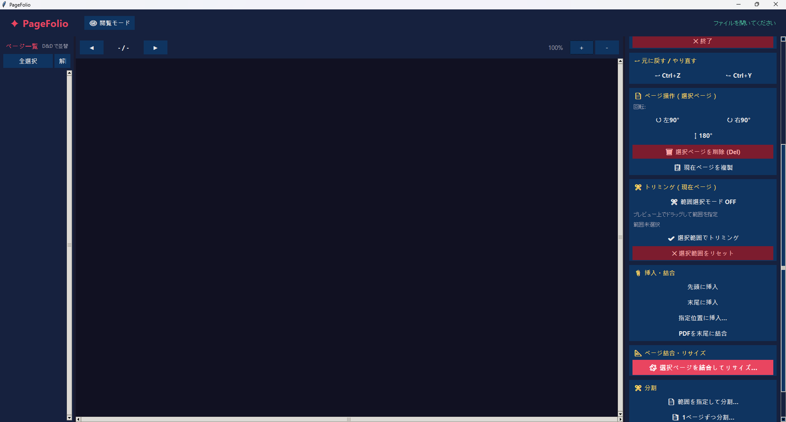
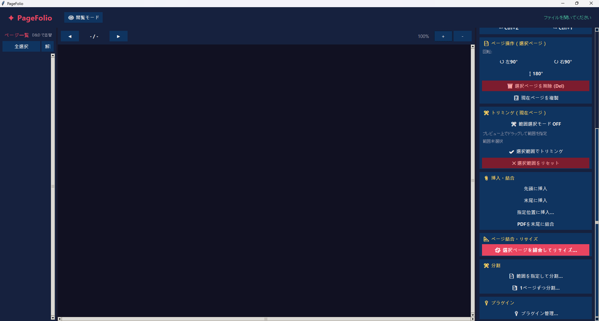
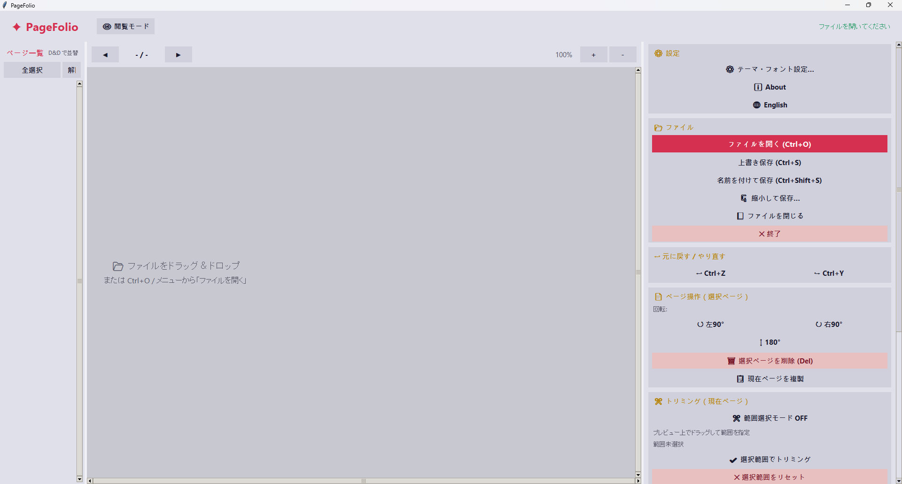
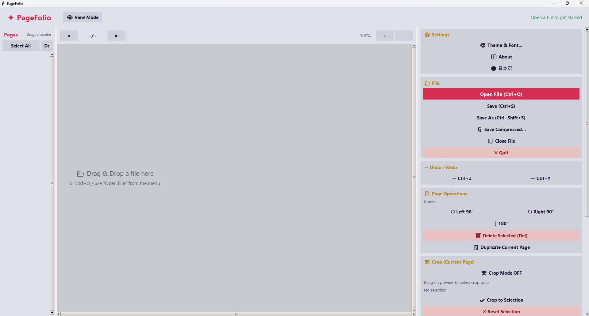
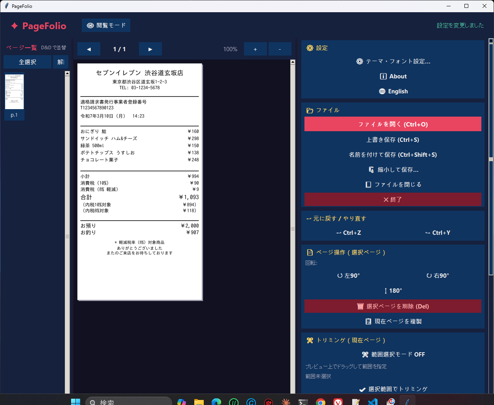
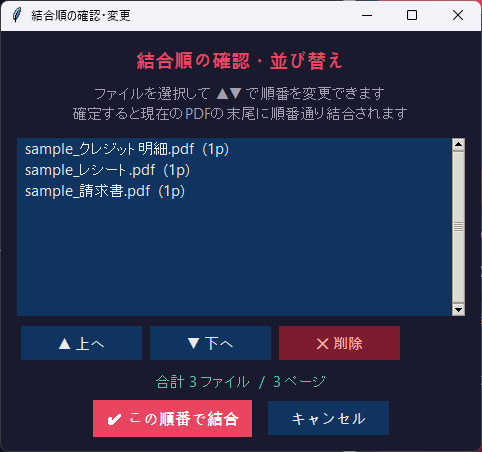

<!-- generated-by: gsd-doc-writer -->
# PageFolio

**PDF ページ整理ツール** — Python + Tkinter 製の Windows 11 向け GUI アプリケーション。
テキスト編集や注釈追加は行わず、**ページ単位の操作**（回転・削除・トリミング・結合・分割・OCR など）に特化しています。


> 📝 本プロジェクトは [Claude Code](https://claude.ai/code)（Anthropic）を活用して開発されています。AI との協調開発のユースケースとして、開発指示書 [CLAUDE.md](CLAUDE.md) と変更履歴 [開発履歴.md](開発履歴.md) も公開しています。

---

## インストール

### エンドユーザー向け（実行ファイル）

Python のインストールは不要です。[Releases](https://github.com/mistyura/PageFolio/releases) から最新の `PageFolio-vX.X.X-win64.zip` をダウンロードし、任意のフォルダに展開して `PageFolio.exe` を実行してください。

> `--onedir` 形式で配布しているため、`PageFolio.exe` と `_internal/` フォルダは同じディレクトリに置いたまま利用してください。

展開先・サンプルプロンプト・更新手順は [配布版（EXE）の使い方](#配布版exeの使い方) を参照してください。

### 開発者向け（ソースから実行）

Python 3.8 以上が必要です。

```bash
git clone https://github.com/mistyura/PageFolio.git
cd PageFolio
pip install -r requirements.txt
```

---

## クイックスタート

```bash
python pagefolio.py
```

1. 起動したウィンドウに PDF・PNG・JPG・BMP・TIFF ファイルをドラッグ＆ドロップするか、「ファイルを開く」から選択します（複数選択時は自動的に結合されます）。
2. サムネイル一覧からページを選択し、右側の操作パネルで回転・削除・トリミングなどを実行します。
3. 「保存」または「名前を付けて保存」で結果を書き出します。

`python -m pagefolio` でも同じアプリを起動できます。

---

## 配布版（EXE）の使い方

配布物は版番号付きのフォルダー（標準の展開先は `PageFolio-v1.10.0`）です。配布元を直接起動せず、フォルダー全体を作業用の別フォルダーへコピーしてから `PageFolio.exe` を実行してください。`PageFolio.exe` と `_internal/` は同じ階層に置いたままにします。同梱の [はじめに.md](distribution/はじめに.md) に最短の手順があり、詳細は [設定リファレンス](docs/CONFIGURATION.md) を参照してください。

### プロンプトのサンプル

OCR 用とサマリ用は別々に用意されています。必要な方だけ、EXE と同じフォルダーへ次の名前でコピーします。サンプルそのものを編集・上書きせず、コピーした実利用ファイルを外部のテキストエディタで編集してください。

| 用途 | コピー元 | コピー後の名前 |
|------|----------|----------------|
| OCR | `ocr_custom_prompt_sample.md` | `ocr_custom_prompt.md` |
| サマリ | `ocr_summary_prompt_sample.md` | `ocr_summary_prompt.md` |

コピー先に同名のファイルがある場合は作業を止め、両方の内容を確認してから残す方を選びます。自動では上書きしません。

### 新しい版への更新

1. 新しい版を、旧フォルダーとは別のフォルダー（例: `PageFolio-v1.10.0`）へ展開します。旧フォルダーは削除せず残します。
2. 引き継ぎたい `pagefolio_settings.json` と、実利用のプロンプト（`ocr_custom_prompt.md` / `ocr_summary_prompt.md`）だけを新しいフォルダーへコピーします。新しいフォルダーに同名ファイルが既にある場合はコピーを止め、内容を確認して選びます。上書きしない運用です。
3. プラグインは自動では移行されません。旧フォルダーを残したまま、[プラグイン開発ガイド](docs/PLUGINS.md) の導入手順で新しいフォルダーへ入れ直してください。
4. 問題が起きた場合は、旧フォルダーの `PageFolio.exe` を起動すれば元の版へ戻れます。

### 保証範囲と未実施の確認

- 起動排他と既存画面への復帰は、排他に対応した版同士が同じ session で起動された場合が対象です。別の配置フォルダー・Python 起動・EXE 起動の混在も、対応版同士で同じ session であれば対象です。
- 排他未対応の旧版との同時起動、および OS が行う強制的な前面化の拒否は保証外です。この場合、起動中の画面が前面に出ないことがあります。
- 配布 EXE の実機受入と出荷承認は未実施です。ビルド時の照合成功は、同梱ファイルの内容一致を機械的に確認した結果であり、実機での合格を意味しません。
- 再ビルドの手順（保守担当者向け）は [docs/DEVELOPMENT.md](docs/DEVELOPMENT.md) を参照してください。

---

## 使い方の例

### ページの回転・削除

サムネイル一覧で複数ページを選択（Ctrl+クリック）した状態で回転ボタンを押すと、選択した全ページがまとめて回転します。削除も同様に選択ページ単位で実行されます。

### PDF の結合・分割

「挿入・結合」から別の PDF ファイルを指定すると、現在のドキュメントの末尾（または指定位置）にページが追加されます。「分割」ではページ範囲を指定して複数の PDF に分割でき、1 ページずつ個別ファイルに分割することも可能です。

### OCR によるテキスト抽出

右パネルの OCR セクションでプロバイダ（LM Studio / Ollama / Claude / Gemini / RunPod / Tesseract のいずれか）を選び、対象ページを指定して実行すると、`OCRDialog` に抽出結果が表示されます。結果はテキストまたは Markdown 整形表示でコピー・保存できます。詳細は [docs/OCR-PROVIDERS.md](docs/OCR-PROVIDERS.md) を参照してください。カスタムプロンプト・サマリプロンプトが巨大になる場合は、実行ファイルと同じ階層に `ocr_custom_prompt.md` / `ocr_summary_prompt.md` を置くと外部エディタで管理でき、LLM 設定の入力欄と双方向連動します。

---

## 機能一覧

| 機能 | 説明 |
|------|------|
| 📂 ファイルを開く | PDF・PNG・JPG・BMP・TIFF を読み込み（複数選択時は結合） |
| 💾 保存 | 上書き保存 / 名前を付けて保存 |
| 🔄 ページ回転 | 90° / 180° / 270°、複数ページ一括対応 |
| 🗑 ページ削除 | 選択ページをまとめて削除 |
| ✂ トリミング | プレビュー上のドラッグで余白をカット（複数選択ページ一括適用） |
| 📋 ページ複製 | 現在のページを直後に複製して挿入 |
| 📎 挿入・結合 | 別 PDF からページを挿入 / 末尾に結合 |
| 📐 ページ結合・リサイズ | 選択した複数ページを横並び/縦並びで1枚に結合（例: 2× A4 → 1× A3） |
| ✂ 分割 | ページ範囲指定で分割 / 1ページずつ個別PDFに分割（縮小オプション付き） |
| 🖼 画像変換 | ページを画像ファイルに変換（1ページ1ファイル・PNG/JPEG・長辺ピクセル指定） |
| ⬛ 黒塗り・モザイク | ページ上の矩形領域を黒塗り/モザイクで破壊的に編集（`apply_redactions()` によるテキスト・画像の実削除） |
| 🗜 縮小保存 | garbage収集 + 圧縮でファイルサイズを最適化して保存（元ファイルへの上書きにも対応） |
| 🔒 パスワード | パスワードの付与（AES-256 暗号化）/ 解除。保護された PDF は開く際にパスワード入力を要求 |
| 🖨 印刷 | 現在のドキュメントを既定の PDF ハンドラ経由で印刷（Ctrl+P・編集結果を反映、Windows のみ） |
| 🔀 D&D 並び替え | サムネイルをドラッグ＆ドロップでページ順を変更（複数ページ一括移動対応） |
| 📄 ページネーション表示 | 大量ページの PDF でサムネイル一覧をページ単位（既定 20・範囲 10〜100）で窓表示 |
| 🔍 OCR テキスト抽出 | LM Studio / Ollama / Claude / Gemini / RunPod / Tesseract の複数プロバイダに対応 |
| ↩ Undo / Redo | 最大20回の取り消し・やり直し（Ctrl+Z / Ctrl+Y）。大きな PDF でもディスク退避によりメモリを最適化 |
| 🔍 プレビュー | ズーム・スクロール対応、ページ拡大表示 |
| 👁 閲覧/編集モード | ヘッダーボタン（F5）でモード切替。閲覧モードは編集ボタンが非活性 |
| ⚙ テーマ・フォント | ダーク / ライト / システム連動、フォントサイズ変更 |
| 🪟 ウィンドウ状態引き継ぎ | 前回終了時のウィンドウ位置・サイズを次回起動時に復元 |
| 🧩 プラグイン | サードパーティ製プラグインによる機能拡張（`pagefolio/plugins.py`） |

---

## 画面構成








---

## 注意事項

- トリミング・回転・削除は **選択中のページ** が対象です（未選択の場合は現在ページ）
- 保存前にアプリを閉じると編集内容は失われます
- パスワード保護された PDF は開く際にパスワードの入力が必要です（パスワードの付与/解除は「🔒 パスワード」から）
- 黒塗り・モザイクは破壊的操作です。矩形下のテキスト・画像・交差する注釈が実際に削除されます（`page_edit` の Undo で復元可能）
- 印刷は OS の既定 PDF アプリを利用します（Windows のみ対応）
- クラウド OCR（Claude / Gemini / RunPod）はページ画像を base64 で外部 API へ送信します。API キーは設定ファイルに保存されず、環境変数またはセッション中のメモリのみに保持されます

---

## ドキュメント

| ドキュメント | 内容 |
|--------------|------|
| [docs/GETTING-STARTED.md](docs/GETTING-STARTED.md) | 開発環境での動作確認までの手順 |
| [docs/DEVELOPMENT.md](docs/DEVELOPMENT.md) | ローカル開発・ビルドコマンド・コードスタイル・ブランチ運用 |
| [docs/ARCHITECTURE.md](docs/ARCHITECTURE.md) | モジュール構成・データフロー・拡張ポイント |
| [docs/TESTING.md](docs/TESTING.md) | テストフレームワーク・実行方法・カバレッジ |
| [docs/CONFIGURATION.md](docs/CONFIGURATION.md) | `pagefolio_settings.json` の設定項目リファレンス |
| [docs/OCR-PROVIDERS.md](docs/OCR-PROVIDERS.md) | OCR プロバイダの詳細・モデル選定・ハルシネーション対策 |
| [docs/PLUGINS.md](docs/PLUGINS.md) | プラグイン開発ガイド |
| [CONTRIBUTING.md](CONTRIBUTING.md) | 貢献ガイドライン（PR プロセス・Issue 報告） |
| [CLAUDE.md](CLAUDE.md) | AI（Claude Code）向け開発指示書 |
| [開発履歴.md](開発履歴.md) | バージョンごとの変更ログ |

---

## 貢献

バグ報告・機能提案・コード貢献は歓迎します。詳細は [CONTRIBUTING.md](CONTRIBUTING.md) を参照してください。
不具合・要望は [Issues](https://github.com/mistyura/PageFolio/issues) からお知らせください。

---

## テスト・リント

```bash
ruff check . && ruff format .   # リント・フォーマット
pytest                          # テスト実行
```

テストは GUI (Tkinter) を起動せずにヘッドレスで実行できます。詳細は [docs/TESTING.md](docs/TESTING.md) を参照してください。

---

## ライセンス

MIT License — 詳細は [LICENSE](LICENSE) を参照してください。
